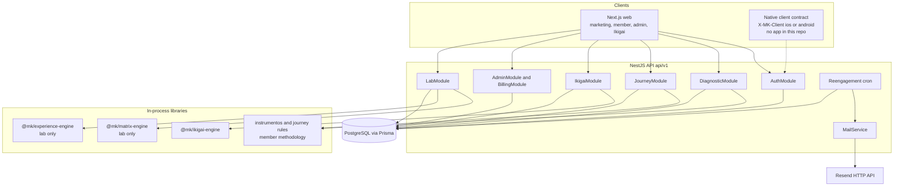

# Career Engineering Context: Maximus Kratos

Analysis date: 15 October 2026.
Scope: working tree of the `maximuskratos` repository.
Method: source, schema, configuration, and tests. Marketing copy is used only to name the product, and is marked when it is not the same thing as an executable path.

This document describes software that exists in the repository. It does not assign files or commits to one person. It does not report revenue, users, traffic, or performance.

Evidence labels used below:

- **Verified:** present in executable application code, schema, tests, or deployment configuration.
- **Documented:** stated in README, comments, or UI copy, and not treated as runtime behavior unless code agrees.
- **Unclear:** not established by this inspection.
- **Provided context:** employment framing supplied for this career document, not proven by repository metadata.

---

## 1. Executive Project Overview

**Verified.** Maximus Kratos is a Spanish-language web product for personal development. The repository implements:

- a public marketing site
- email-and-password accounts
- a multi-module diagnostic questionnaire
- a member area for purpose, plans, weekly actions, and review
- a public Ikigai instrument that can run without a member account
- an admin console for users, leads, and plan catalog
- an admin-only methodology lab that scores cases with a frozen diagnostic matrix

The runtime is one npm workspace with six packages:

| Package | Role |
| --- | --- |
| `@mk/web` | Next.js 15 App Router client |
| `@mk/api` | NestJS 11 REST API, global prefix `api/v1` |
| `@mk/database` | Prisma schema, migrations, catalog seed |
| `@mk/matrix-engine` | Frozen Matrix v2 assessment engine, used by the lab |
| `@mk/experience-engine` | Direction and experience projection for the lab |
| `@mk/ikigai-engine` | Ikigai definition, draft rules, and result builder |

PostgreSQL is the system of record. Prisma is the only data access layer found. There is no second service, no queue, and no native mobile project in this tree.

The member product and the lab do not share a scoring engine. Member completion uses the formulario catalog and the `instrumentos` modules. Matrix v2 `runAssessment` is called from the lab. An isolation test forbids matrix and experience imports under the member diagnostic, journey, and database source trees (`apps/api/test/instrumentos-isolation.test.ts`).

**Provided context.** The developer implements this software for an external client and does not own Maximus Kratos.

**Verified absence.** Simplehora and Simplereserva do not appear in this repository. No architecture, customers, or infrastructure are shared with them here.

The root `README.md` still describes the project as “Web platform and REST API for user accounts and authentication” and lists only `apps/api`, `apps/web`, and `packages/database`. That description is **documented and stale**. The engines, questionnaire, journey, Ikigai module, and lab are **verified** in code.

---

## 2. Product Ownership and Development Context

### What this repository is

**Verified.** Package name `maximuskratos` (`package.json`). API service name `maximus-kratos-api` (`apps/api/src/health/health.controller.ts`). Public site URL `https://maximus-kratos.com` is the documented production canonical origin (`README.md`, `apps/web` env example comments, `NEXT_PUBLIC_SITE_URL`).

### Maximus Kratos

**Provided context.** Software developed for an external client. The developer’s responsibility is software engineering and implementation. The developer is not the founder or owner.

**Verified in the product itself.** The software distinguishes operators (`Role.ADMIN`) from members (`Role.USER`). Nothing in the schema models the developer as an owner. Landing copy speaks of “fundador” as a member status for early accounts (`apps/web/lib/landing-copy.ts`), which is a product concept, not an authorship claim.

### Simplehora and Simplereserva

**Verified.** No matches for those names in the repository. They are independent products in the supplied career context, and this tree cannot describe their functionality, architecture, customers, or operations.

Engineering and product-building responsibilities for those two products are therefore **out of scope for this file**. A resume that covers them needs their own repositories.

### Authorship boundary

**Unclear, by design of this review.** The working tree contains a large amount of application code. Git history was not used to decide who wrote each module. Descriptions below mean “the repository implements,” not “one developer personally authored every line.”

Where a behavior is only a comment, a stub, or marketing copy, it is labeled that way so it is not described as shipped product.

### Maturity inside this repository

| Surface | Status in this tree |
| --- | --- |
| Marketing pages, legal pages, contact lead form | Implemented UI. Events page copy includes upcoming content. |
| Register, login, refresh, logout, password reset | Implemented API and web. |
| Diagnostic player and profile | Implemented for authenticated members. Active catalog label is `formulario-completo`. |
| Member journey: purpose, plans, domains, calendar, week close, accompaniment | Implemented API, persistence, and member screens, with domain and component tests. |
| Public Ikigai player | Implemented, token-scoped, separate from the member shell. |
| Admin users, leads, plan catalog | Implemented. |
| Admin lab (Matrix v2 workbench) | Implemented internal tool. Not a member workflow. |
| Plan prices and trial settings | Implemented as catalog data. |
| Charging a card, Mercado Pago subscriptions, subscription enforcement | Schema and a no-op guard. No payment client or webhook. |
| iOS and Android applications | Not in the repository. API accepts `X-MK-Client: ios|android` for refresh-token shape. Marketing copy says the apps are in development. |
| Reengagement email cron | Implemented, and skipped while `EARLY_ACCESS_MODE` is true. |

`EARLY_ACCESS_MODE` is `true` in both API and web (`apps/api/src/product-phase.ts`, `apps/web/lib/product-phase.ts`). Public copy stays in early-access language. Any authenticated user still receives `canUseMemberProduct: true` (`apps/api/src/auth/member-access.ts`). A preview flag is separate: it is true only when early access is on and the user id is listed in `MEMBER_PREVIEW_USER_IDS`.

---

## 3. Product Capabilities and User Workflows

### Product purpose

**Verified from product copy and from the flows that persist data.** The public site describes a personal-development product for men: see the distance between stated values and current life, write a purpose route, and turn that into plans and actions that can be reviewed (`apps/web/lib/landing-copy.ts`).

The implemented member loop matches that shape:

1. Account.
2. Questionnaire (`formulario-completo`).
3. Purpose sheet and alignment reading.
4. Priority and plans, gated until the questionnaire and a working direction exist.
5. Actions in three domains: `MENTE`, `ESPIRITU`, `CUERPO`.
6. Daily records and a weekly close.
7. Optional accompaniment proposal, experiment observations, and a guidance request stored for a human follow-up.

**Who uses it, from the implementation.**

| Role | Evidence |
| --- | --- |
| Anonymous visitor | Marketing routes, lead form, public plan list, public Ikigai session. |
| Member (`USER`) | Diagnostic, journey, profile, account. |
| Operator (`ADMIN`) | `/admin` users, leads, plans, and `/admin/lab`. Admins who hit the member shell are sent to `/admin`. |
| Ikigai participant | Session id plus `x-ikigai-token`. No JWT required to create a session. |

There is no organization, team, coach account, or multi-tenant company model. Isolation is per `User` row.

**Domain complexity that is actually in the code.** The hard part is not CRUD. It is keeping several methodologies from contaminating each other, scoring only when coverage rules say a total is valid, refusing plan content that conflicts with health or safety declarations, and making week and priority writes idempotent.

### Workflow A. Account registration and session

1. **Start.** `/register` or `/login` (`apps/web/app/register/page.tsx`, `apps/web/app/login/page.tsx`).
2. **Client.** `AuthSessionProvider` stores the access token in web storage and calls `/auth/me` (`apps/web/components/auth-session-provider.tsx`, `apps/web/lib/auth-storage.ts`, `apps/web/lib/resolve-session.ts`).
3. **API.** `POST /api/v1/auth/register`, `login`, `refresh`, `logout`, `logout-all`, `forgot-password`, `reset-password`, `GET /auth/me` (`apps/api/src/auth/auth.controller.ts`).
4. **Rules.** bcrypt cost 12. Access JWT 15 minutes, payload `sub`, `email`, `role`. Refresh token is 48 random bytes, stored as SHA-256, rotated inside a transaction that updates only a still-valid row (`apps/api/src/auth/auth.service.ts`). Web refresh uses httpOnly cookie `mk_refresh`. Header `X-MK-Client: ios|android` forces the refresh token to come from the JSON body, so a cookie cannot be echoed to a native client (`apps/api/src/auth/client-kind.ts`).
5. **Data.** `User`, `RefreshToken`, `PasswordResetToken`, `Subscription` created as `TRIAL` with `trialEnd: null`.
6. **External.** Resend for welcome, reset, and admin notification when `RESEND_API_KEY` is set. Without it, reset URLs are logged (`README.md`, `apps/api/src/mail/mail.service.ts`).
7. **Background.** None on this path.
8. **Failure.** Invalid password and invalid refresh return unauthorized. Concurrent refresh loses if `updateMany` count is not 1. Password reset revokes refresh tokens. Validation pipe rejects unknown DTO fields (`apps/api/src/main.ts`).

### Workflow B. Diagnostic questionnaire

1. **Start.** Authenticated member opens `/diagnostico`. `DiagnosticAccessGate` sends guests to login (`apps/web/app/diagnostico/layout.tsx`).
2. **Client.** `DiagnosticEntry`, `DiagnosticWelcome`, `DiagnosticPlayer`, `ModuleOutro`, `QuestionCard`, option components under `apps/web/components/diagnostico/`. API client in `apps/web/lib/api.ts`.
3. **API.** `POST /api/v1/diagnostic/start`, `GET /state`, `POST /response`, `POST /welcome-seen`, `POST /outro-seen/:moduleSlug`, `POST /restart`. `GET /progress` and `GET /profile` are JWT-only and do not use `DiagnosticOpenGuard`.
4. **Rules.** Catalog bootstrap activates `formulario-completo` (`apps/api/src/diagnostic/diagnostic-catalog.service.ts`, health payload `catalog: 'formulario-completo'`). Answers pass `validateSubmission` and parent/child disposition (`apps/api/src/diagnostic/answer-rules.ts`, `question-capture.ts`): exceptions `UNKNOWN`, `NOT_APPLICABLE`, `DECLINED`, `PENDING`; birthdate bounds; selection limits. `revisionDecision` returns `conflict` when the client’s expected revision does not match the stored row. One `ACTIVE` session per user (partial unique index `diagnostic_sessions_one_active`). Restart abandons an incomplete session and opens another. Completion is idempotent if a `MasterProfile` already exists (`diagnostic.service.ts` `completeDiagnostic`). For `definitionRef === 'formulario-completo'`, archetype is stored as `sin-clasificar` and formulario reading plus initial alignment are materialized. Older dimension-delta scoring still writes `ScoreSnapshot` rows inside `recalculateScores`. Excel-style section bands are persisted from `excel-score.ts` on outro and completion.
5. **Data.** `DiagnosticVersion`, `DiagnosticModule`, `Question`, `AnswerOption`, `DiagnosticSession`, `UserModuleProgress`, `Response`, `ResponseRevision`, `ScoreSnapshot`, `DiagnosticEvent`, `MasterProfile`, `DiagnosticFormResult`, then `CoreReading` for the initial alignment.
6. **External.** None on the answer path.
7. **Background.** `ReengagementService` would email incomplete sessions at 24h, 48h, and 7d. The cron returns immediately while early access is on (`apps/api/src/diagnostic/reengagement.service.ts`).
8. **Failure.** Conflict on stale revision. Guard currently allows every authenticated user because `canUseMemberProduct` is hard-coded true. The forbidden copy in `DiagnosticOpenGuard` is unreachable with the current access function.

### Workflow C. Purpose, priority, and plan writing

1. **Start.** Member opens `/proposito`, then `/planes` or a domain page (`/mente`, `/espiritu`, `/cuerpo`).
2. **Client.** `PurposeScreen`, `PlansScreen`, `AmbitTasks` via `apps/web/lib/journey-api.ts`.
3. **API.** Under `/api/v1/journey`, all routes use `JwtAuthGuard` and `DiagnosticOpenGuard`: purpose read/write, synthesis, alignment, priority preview and confirm, plans and actions, depth, measurements.
4. **Rules.** `writerBlock` refuses plan and action writes until a persisted formulario completion exists and direction status is `EXPLORANDO`, `PROVISIONAL`, or `CONFIRMADO_POR_USUARIO` (`apps/api/src/journey/plan-gate.ts`). Plan link kinds are `DIRECT`, `ENABLING`, `PROTECTIVE`, `EXPLORATORY`. Declared content tags are parsed and unknown tags are refused. `decideAction` in `instrumentos/restrictions.ts` can refuse exertion, diet, supplements, medication, confrontation, or financial tags when health facts or an unsafe conversation say so. Priority proposals come from `prioridades@0.1` (`journey/priority.ts`) and confirm is idempotent on `commandKey`. Purpose revisions are unique per `(userId, revision)`. HDRP text assembly lives in `journey/hdrp-contract.ts` and uses the same 15-point bands as the spreadsheet-style scorer.
5. **Data.** `PurposeRevision`, `PersonalPlan`, `PlanAction`, `PriorityDecision`, `PriorityHead`, `CoreReading`, `MemberClarification`.
6. **External.** None.
7. **Background.** None. Guidance requests are a synchronous insert.
8. **Failure.** Writer block returns a code and a next href (`/diagnostico` or `/proposito`). Repeated priority confirms with the same command key return the existing decision.

### Workflow D. Calendar, records, and week close

1. **Start.** `/calendario`, or recording an action from a domain page.
2. **Client.** `CalendarScreen`.
3. **API.** `GET /journey/calendar`, `POST /journey/records`, `POST /journey/weeks/preview`, `POST /journey/weeks/close`, `GET /journey/weeks`. Occasion cancel is `POST /journey/occasions/cancel` on the accompaniment controller.
4. **Rules.** `previewWeek` maps each action to `KEEP`, `REDUCE`, `SUBSTITUTE`, `PAUSE`, `RESUME`, `CLOSE`, `MODIFY`, or `RETIRE`, and rejects an empty change (`apps/api/src/journey/apply-week.ts`). `occasionTally` does not treat a missing record as an omission (`journey/execution.ts`). Records are unique on `(actionId, day)`. Week reviews are unique on `(userId, weekStart)`, default timezone `America/Santiago`.
5. **Data.** `PlanAction`, `ActionRecord`, `OccasionCancellation`, `WeekReview`.
6. **External.** None.
7. **Background.** None. Close is synchronous.
8. **Failure.** Unique constraints reject a second record for the same action and day. Preview is a pure function and does not write.

### Workflow E. Accompaniment and experiments

1. **Start.** Plan screen loads a preview, member confirms, later records experiment observations.
2. **Client.** `AccompanimentFlow`, `DevolucionView`, `ExperimentObservations`.
3. **API.** `GET /journey/devolution`, `POST /journey/accompaniment/preview`, `POST /journey/accompaniment`, experiment observation, hypothesis, and review routes (`accompaniment.controller.ts`).
4. **Rules.** `propose` path in `accompaniment/rules.ts` takes goal, territory, situation, occasions, minutes, barriers, health limits, and requested tags. Versions are explicit (`CATALOG_VERSION`, `ENGINE_VERSION`, `RULES_VERSION` in `accompaniment/vocab.ts`). Confirm stores `AccompanimentDecision`. Command keys are unique per `(userId, commandKey)` after migration `20261013234500_command_key_per_account`.
5. **Data.** `AccompanimentDecision`, `AccompanimentHead`, `IkigaiExperiment`, `IkigaiExperimentRevision`, `ExperimentObservation`, `ExperimentReview`.
6. **External.** None. This is not a call to an LLM or a third-party coach API.
7. **Background.** None.
8. **Failure.** Restriction refusals and clarification states are part of the rule output, not an uncaught exception path only.

### Workflow F. Public Ikigai

1. **Start.** Marketing page `/ikigai`, then `/ikigai/empezar` and `/ikigai/s/[sessionId]`.
2. **Client.** `apps/web/components/ikigai/*`, `apps/web/lib/ikigai-api.ts`, local autosave in `apps/web/lib/ikigai-ui/`.
3. **API.** `GET /api/v1/ikigai/definition`, `POST /sessions`, then session routes guarded by `IkigaiAccessGuard`.
4. **Rules.** `@mk/ikigai-engine` validates drafts, derives tensions, and builds a result. Definition identity is pinned (`EXPECTED_DEFINITION_SHA256` in the engine). The guard compares the presented token with a stored hash using `timingSafeEqual` (`apps/api/src/ikigai/ikigai-access.guard.ts`).
5. **Data.** `IkigaiDefinition`, `IkigaiSession` (unique `token_hash`), `IkigaiResultSnapshot` unique on `(sessionId, revision)`.
6. **External.** None.
7. **Background.** None.
8. **Failure.** Missing or wrong token is not found or forbidden. Completion validation rejects an incomplete draft.

### Workflow G. Admin operations and methodology lab

1. **Start.** User with `role === ADMIN` opens `/admin` or `/admin/lab`.
2. **Client.** `AdminShell`, lab pages under `apps/web/app/admin/lab/**`, client `apps/web/lib/lab-api.ts`.
3. **API.** `/api/v1/admin/users|leads|stats`, `/api/v1/admin/plans`, and a large `/api/v1/admin/lab/*` surface (`lab.controller.ts`): definitions, workspaces, cases, runs, freeze, result, trace, expectations, reviews, replays, changesets, findings, readiness.
4. **Rules.** `RolesGuard` plus `@Roles('ADMIN')`. Lab runs call `@mk/matrix-engine` `runAssessment` and `@mk/experience-engine` projection and lab gates. Real-case entry is gated by `LAB_REAL_CASES_ENABLED` through `realCasesAllowed`.
5. **Data.** The `Lab*` and `Experience*` models in `schema.prisma`.
6. **External.** Matrix import CLI can read XLSX inside `@mk/matrix-engine` (`matrix:import`). That is an operator script, not a member upload endpoint.
7. **Background.** None. Freeze and replay are request-scoped.
8. **Failure.** Non-admin callers are rejected by the role guard. Lab gates block mutation after freeze (`experience-engine` `lab-gates.ts`).

### Workflow H. Public lead and plan catalog

1. Contact form posts `POST /api/v1/leads` (throttled). Stored as `Lead`.
2. Pricing page reads `GET /api/v1/billing/plans`. Admin edits plans and `BillingSettings`.
3. Register CTAs go to account creation. No checkout call exists in the web app.

### Workflows worth using in an interview

Use B, C, D, and G. They show domain rules, concurrency, and an architectural boundary. Use A when the conversation is about sessions. Use F when the conversation is about a public instrument with its own credential. Do not describe H as a payments system.

---

## 4. Technical Stack

Versions are the ranges declared in package manifests unless noted as a pinned tool version.

### Implemented and used

| Area | Technology | Evidence |
| --- | --- | --- |
| Language | TypeScript ^5.8.3 | All app and package manifests |
| Runtime | Node 22 (`engines.node`, `.nvmrc`, CI `node-version: 22`) | Root `package.json`, `.github/workflows/ci.yml` |
| Monorepo | npm workspaces `apps/*`, `packages/*` | Root `package.json`. No Turborepo or pnpm workspace file. |
| API | NestJS ^11.1.2, Express platform, Swagger ^11.2.0 in non-production | `apps/api` |
| Web | Next.js ^15.3.2, React ^19.1.0, App Router, `output: 'standalone'` | `apps/web` |
| API style | REST JSON, prefix `api/v1`, cookie parser | `apps/api/src/main.ts` |
| Validation | `class-validator` / `class-transformer`, global `ValidationPipe` whitelist | API |
| Web validation | Hand-written checks in components and `answer-rules` mirrored on the server | No zod, react-hook-form, or TanStack Query in `apps/web/package.json` |
| State | React context for session. Local `useState` per screen. | `AuthSessionProvider` |
| Styling | Tailwind CSS ^4.3, tokens in `apps/web/app/globals.css`, some `class-variance-authority` | Web |
| UI kits present in the bundle | `@base-ui/react`, `lucide-react`, a small `components/ui` surface, Motion ^12, Lenis on the public site, Recharts on profile views | Web dependencies and component imports |
| Auth | `@nestjs/jwt`, bcrypt ^6, httpOnly refresh cookie | `auth.service.ts` |
| Database | PostgreSQL 16 in Docker Compose and CI | `docker-compose.yml`, CI workflow |
| ORM | Prisma ^6.8.2, `@prisma/client` | `packages/database` |
| Mail | Resend HTTP API | `mail.service.ts` |
| Schedule | `@nestjs/schedule`, one cron | `ReengagementService` |
| Rate limit | `@nestjs/throttler` global guard | `app.module.ts` |
| Security headers | `helmet` on the API. Next.js headers for HSTS, nosniff, frame, referrer, permissions | `main.ts`, `next.config.ts` |
| Tests | Vitest ^3.2.4, Testing Library, Supertest, Playwright 1.61.1 | Package manifests, `playwright.config.ts` |
| Local DB | Docker Compose Postgres only | `docker-compose.yml` |
| Deploy config | Railpack JSON for API and web, start script runs `prisma migrate deploy` | `railpack.json`, `railpack.web.json`, `scripts/start-api.sh` |
| CI | GitHub Actions, one job, Postgres service | `.github/workflows/ci.yml` |
| Hooks | Husky `prepare`. Pre-push runs a build script, not the test script. | Root `package.json`, `scripts/pre-push.sh` |

### Configured, usage limited or not on the member path

| Item | What is true |
| --- | --- |
| `JWT_REFRESH_SECRET` | Documented in `.env.example` and README as reserved. Refresh tokens are opaque database secrets, not JWTs signed with that value. |
| Mercado Pago columns | `Subscription.mpCustomerId`, `mpSubscriptionId`, and plan `providerId` exist. No Mercado Pago SDK or webhook controller. |
| `SubscriptionGuard` | Registered as a class that always returns true. |
| Swagger | Mounted only when `NODE_ENV !== 'production'`. |
| HTTP trace | `MK_TRACE_HTTP` helper used by integration tests, not wired in `bootstrap`. |
| `xlsx` | Dependency of `@mk/matrix-engine` for the import CLI. |
| shadcn package | Dependency is installed. Most UI is custom CSS, not a generated shadcn component set. |

### Documented or planned, not implemented in this tree

| Item | Evidence |
| --- | --- |
| iOS and Android apps | Landing status pills. API client header only. No `ios/` or `android/` project. |
| Card checkout and subscription billing | Schema stub migration `20260520130000_subscriptions_stub`. Guard comment says it will be wired with billing. |
| Product docs under `docs/phase-1` and `docs/phase-2` | README says they are local and not in git. They were not in this working tree. |
| Sentry, OpenTelemetry, Datadog, queues, Redis, object storage, Terraform, Kubernetes, Dockerfile | Not found as application infrastructure. |

### Explicitly not in the production member path

`@mk/matrix-engine` and `@mk/experience-engine` are real libraries and are used by `LabService`. They are not imported by member diagnostic or journey code. Describing Matrix v2 as the live member scorer would be inaccurate.

---

## 5. Architecture and Component Diagram

**Verified.** Modular monolith. One API process, one web process, one PostgreSQL database. Domain libraries are in-process packages, not network services.

### Boundaries

- **Web vs API.** The browser does not import Prisma or the scoring engines. Member data is loaded with `fetch` and a bearer token. In local development, Next rewrites `/api/v1` to the API origin (`apps/web/next.config.ts`). Production web and API are separate Railway services in the documented deploy layout.
- **Member methodology vs lab methodology.** Enforced by package imports and `instrumentos-isolation.test.ts`, and by a workspace rule that Matrix v2 scoring is not to be patched to satisfy later product ideas (`.cursor/rules/matrix-v2-frozen.mdc`). That rule is a repository instruction. The isolation test is the executable check.
- **Public Ikigai vs member journey.** Separate routes, separate auth (`x-ikigai-token` vs JWT), separate tables. A member can still work with Ikigai-related experiments inside the journey (`IkigaiExperiment` belongs to `User`).
- **Admin vs member.** Role on the JWT. Web shells redirect admins away from the member chrome and non-admins away from `/admin`.

### Layering

Controllers are thin. Business rules often sit in plain TypeScript modules that do not import Nest or Prisma (`answer-rules.ts`, `apply-week.ts`, `priority.ts`, `accompaniment/rules.ts`, `instrumentos/*`, matrix `engine/*`). Services own transactions and persistence. That split is what the unit tests under `apps/api/test` and the engine packages exercise without HTTP.

### Communication

Synchronous HTTP only, aside from the reengagement cron and outbound email. No event bus, no webhooks, no server-sent events, no WebSockets.

### Dependency injection

Nest module providers. `PrismaModule` and `MailModule` are global. Guards are class-scoped or method-scoped, plus one global `ThrottlerGuard`.

### Consistency choices visible in code

- Refresh rotation uses a conditional `updateMany` so two concurrent refreshes cannot both succeed.
- Diagnostic responses use a revision number and return conflict instead of last-write-wins.
- Priority, accompaniment, core readings, and measurements use `commandKey` unique constraints so a retry does not duplicate a decision.
- Week reviews and action records use natural unique keys (`userId + weekStart`, `actionId + day`).
- One active diagnostic session per user is a partial unique index, not an application-only check.
- Lab runs snapshot results and traces at freeze time rather than rescoring silently later. Replay is a separate record (`LabReplayRun`).

### What this architecture is not

It is not a microservice system, not multi-tenant SaaS, and not a queue-backed workflow engine. Scalability, distribution, and enterprise claims are not supported by the implementation.

---

## 6. Backend Engineering

Global prefix `api/v1` except `GET /health`. Modules registered in `apps/api/src/app.module.ts`: Auth, Leads, Admin, Billing, Diagnostic, Journey, Lab, Ikigai, plus Prisma and Mail.

### Diagnostic capture and two scoring tracks

**Verified and nontrivial.** `DiagnosticService.submitResponse` validates, writes `Response` plus `ResponseRevision`, and recalculates snapshots. Completion writes `MasterProfile` and, for the formulario catalog, a reading that the journey later treats as the gate `formularioCompleted`.

`recalculateScores` still aggregates `option.scoreDeltas` into dimension snapshots. That path is legacy relative to el formulario. formulario completion does not derive the old archetype. Excel-style bands in `excel-score.ts` reproduce form totals (audit bands on a 23 to 115 scale, finance and relation blocks) and record an explicit discrepancy when a summary cell averages unequal sections (`instrumentos/score.ts` notes that “RESUMEN D15” is not the audit total).

`instrumentos/core-index.ts` builds an alignment index only from eligible answers. Exceptions and missing items do not become zeros. `iad.ts` is labeled a draft index (`iad-mk-0.1-borrador`) and normalizes 1–5 answers only when a whole pillar is present.

**Why it is hard.** Partial questionnaires, skipped items, and inverse items must not be scored as if they were answered. The code prefers “not calculable” over a false total.

### Matrix v2 engine, lab only

**Verified.** `runAssessment` (`packages/matrix-engine/src/engine/run-assessment.ts`) verifies a definition hash, classifies responses, evaluates safety, scores dimensions and domains, applies coverage gates, assigns state bands, selects priority, and returns recommendations plus a trace of interpretation ids. Safety overrides can change state when a critical or high risk fires (`engine/safety.ts`). Policies include audit-only, audit plus core, and branching.

Golden JSON fixtures live under `packages/matrix-engine/test/golden/`. A CLI imports the matrix from XLSX and can run a case (`matrix:import`, `matrix:case`).

The lab service persists runs, expectations written before reveal, reviews, safety assessments, direction readings, experience projections, changesets, and replays. That is a validation workbench for a methodology, with blind expectation and later comparison, not the member app.

### Journey rules

**Verified.**

- **Plan gate.** No plans before formulario completion and a working direction.
- **Content restrictions.** Tags such as `PHYSICAL_EXERTION`, `DIET`, `MEDICATION`, `CONFRONTATION`, `DEBT` are decided against health facts. A confirmed limit is a refusal. An answerable gap asks for clarification (`restrictions.ts`, `plan-gate.ts`).
- **Priority.** `prioridades@0.1` maps interest, capacity, direction, and health into a focus. Unknown interest labels stay null instead of being inferred from free text (`priority.ts`).
- **Week effects.** Pure preview, then a persisted close. Decisions include reduce, substitute, pause, retire.
- **Execution math.** Occasion tallies separate planned, done, cancelled, and days with no information.
- **Home board.** `home-board.ts` maps facts to a situation such as `QUESTIONNAIRE`, `EXPLORING`, `GUIDED`, `PAUSED`, `RETURN` for the member home screen.
- **HDRP contract.** Assembles a purpose document from stored lenses, activities, OCEAN-style item groups, and relation or finance bands. Missing lenses stay “Pendiente” rather than a generated sentence (`hdrp-contract.ts`).
- **Accompaniment.** A rule module proposes an activity, scope, and allowed tags from structured input. It calls the same restriction function as plan writing. It is deterministic application code.

`JourneyService` is the persistence facade for these rules. `commandKey` checks happen before insert.

### Auth and access

Covered in section 9. Backend-relevant design: refresh rotation is a compare-and-set on `revokedAt`, and client kind is explicitly “never an authorization signal” (`client-kind.ts`).

### Billing

**Verified, narrow.** `BillingService` lists active plans, computes a monthly equivalent, and upserts a singleton `BillingSettings` row for trial days. Admin can create and patch plans. Currency default on `Plan` is `CLP`. There is no invoice, charge, proration, or webhook handler.

### Mail and cron

`MailService` posts to `https://api.resend.com/emails`. Addresses at `@fixtures.mk.invalid` are skipped so tests do not send. The cron scans incomplete sessions and writes a `DiagnosticEvent` per nudge type so the same trigger is not sent twice. It does not run in early access.

### Lab size and character

`LabController` exposes on the order of sixty routes: definition accept/reject, workspace materialize, case and run lifecycle, batch responses, freeze, trace, blind expectation, reveal, review verdicts, replays, findings, migration decisions, readiness. `LabService` is the largest service in the API. This is internal methodology software with its own persistence model. It should be described as an internal workbench, not as a customer-facing feature.

### Stubs

| Piece | Behavior |
| --- | --- |
| `SubscriptionGuard.canActivate` | Returns true. |
| `ResponseWriteHook` | No-op unless a test replaces it. |
| `requestGuidance` | Inserts `GuidanceRequest` with `status: 'SENT'`. No outbound routing in the service. |
| Trial end | Left null at registration, with a comment that it is set at launch. |

---

## 7. Frontend and UX Engineering

### Routing

Next.js App Router.

| Area | Routes | Shell |
| --- | --- | --- |
| Marketing | `/`, `/manifiesto`, `/marco-central`, `/sistema`, `/precios`, `/contacto`, `/eventos`, `/ikigai`, `/privacidad`, `/terminos` | `(public)` layout, motion on marketing pages |
| Auth | `/login`, `/register`, `/forgot-password`, `/reset-password` | `AuthShell`, guest-only hook |
| Member | `/panel`, `/ruta`, `/perfil`, `/proposito`, `/planes`, `/calendario`, `/mente`, `/espiritu`, `/cuerpo`, `/asesores`, `/cuenta`, `/diagnostico/resultado` | `(member)` `AppShell` |
| Diagnostic | `/diagnostico`, `/diagnostico/bienvenida`, module question and outro | Own layout, no member tab bar |
| Ikigai player | `/ikigai/empezar`, `/ikigai/s/[sessionId]`, result | `ikigai.css`, not the member shell |
| Admin | `/admin`, users, leads, planes, `/admin/lab/**` | `AdminShell` |
| Legacy | `/app` redirects by role. `/bienvenido` redirects to `/panel`. | |

`middleware.ts` only matches `/admin` and `/app` and does not enforce a session. Auth redirects are client-side in the shells. That is **verified**. A user with a disabled client can request the HTML. Data calls still require a bearer token.

### Layout and responsiveness

Member chrome: side nav from 960px, bottom tabs and a “Más” sheet below that (`AppShell.tsx`, `globals.css`). Diagnostic layout uses `100dvh`. Root layout sets `viewportFit: 'cover'` and `lang="es"`. Tokens for mobile margin and shell width live in `globals.css`. This is implemented responsive CSS, not only a design-doc claim.

Surface prefixes in CSS separate marketing (`ag-`), member (`mk-`), diagnostic (`dk-`), Ikigai (`ik-`), and lab (`lab-`). `DESIGN.md` is the UI contract the repo points at. `apps/web/DESIGN.md` redirects attention to the root design document.

### Data loading

Member and admin screens are mostly client components. They call `lib/api.ts`, `lib/journey-api.ts`, `lib/lab-api.ts`, or `lib/ikigai-api.ts`. Errors become `JourneyApiError` or inline alerts. There is no shared query cache. Session resolution dedupes `/auth/me` and refresh (`lib/resolve-session.ts`).

Loading states include spinners and skeletons (`DashboardSkeleton`, lab `Skeleton`). Empty and gated copy exists for home phases, locked route steps, and missing profile data. Journey failures render through `JourneyNotice`.

### Demanding interfaces

1. **Diagnostic player.** Module rail, question types (scale, multi, free text, archetype choices), welcome and outro, resume, restart. Client validation before submit, server validation as the authority.
2. **Purpose and plans.** Multi-step HDRP content, alignment, priority confirm, accompaniment preview and confirm, content marks.
3. **Calendar week close.** Preview then commit, per-action decisions, records by civil day.
4. **Admin lab.** Many routes for cases, runs, findings, replays, readiness, and unsaved-change tracking (`UnsavedChangesProvider`). This is the most complex UI in the repo and it is an internal tool.
5. **Public marketing.** Long-form pages, motion, SEO metadata, JSON-LD, sitemap, `llms.txt`. Technically simpler than the player, operationally part of the same Next app.

### Internationalization and realtime

One locale, Spanish, `es_CL` in SEO helpers. No i18n library. No realtime channel. Calendar “today” uses civil dates and a stored timezone on the week review, not a live socket.

### Implemented UX versus intention

Implemented: the flows in section 3 have pages and API clients.

Intention or incomplete surface, from copy in the UI:

- Events page includes upcoming language.
- Public Ikigai metadata says the version is under review.
- Home and profile include locked or “próximamente” blocks for later audits and reports (`InicioDashboard`, `SystemReport.tsx`).
- Landing hero can say the product view is a preview while `EARLY_ACCESS_MODE` is true.
- Advisors screen requests guidance. It is not a directory of advisors.
- Account page shows subscription status and links to pricing. It does not start a payment.

---

## 8. Data Models and Persistence

### Engine and layout

**Verified.** PostgreSQL, Prisma schema `packages/database/prisma/schema.prisma`. 30 migration directories from `20260520120000_init` through `20261013234500_command_key_per_account`. API uses a `PrismaService` that extends `PrismaClient` and connects on module init.

65 models. Grouped by use:

| Group | Models |
| --- | --- |
| Identity and billing | `User`, `RefreshToken`, `PasswordResetToken`, `Subscription`, `Plan`, `BillingSettings`, `Lead` |
| Diagnostic catalog and runtime | `DiagnosticVersion`, `DiagnosticModule`, `Question`, `AnswerOption`, `DiagnosticSession`, `UserModuleProgress`, `Response`, `ResponseRevision`, `ScoreSnapshot`, `DiagnosticEvent`, `MasterProfile`, `DiagnosticFormResult` |
| Purpose and execution | `PurposeRevision`, `MemberClarification`, `PersonalPlan`, `PlanAction`, `ActionRecord`, `WeekReview`, `GuidanceRequest`, `OccasionCancellation` |
| Readings and decisions | `CoreReading`, `QuestionnaireMeasurement`, `MeasurementResponse`, `PriorityDecision`, `PriorityHead`, `DepthConfirmation`, `AccompanimentDecision`, `AccompanimentHead` |
| Member Ikigai experiments | `IkigaiExperiment`, `IkigaiExperimentRevision`, `ExperimentObservation`, `ExperimentReview` |
| Public Ikigai | `IkigaiDefinition`, `IkigaiSession`, `IkigaiResultSnapshot` |
| Lab and experience | 23 models from `LabDefinition` through `LabReadinessDecision`, including `ExperienceDefinition`, `DirectionVersion`, `ExperienceProjectionRecord` |

Enums include `Role`, `SubscriptionStatus`, `QuestionType`, `ScaleType`, `DiagnosticSessionStatus`, lab statuses, `PersonalPlanStatus`, `ActionRecordStatus`, `ActionDomain`.

### Modeling decisions that interview well

1. **Catalog version, not a rewritten questionnaire.** `DiagnosticVersion` has `definitionRef` and `definitionSha256`. Sessions point at a version. Later migrations add question `sourceRef`, `instrument`, and `polarity` without destroying stored responses (`20261007190000_formulario_completo_source` follows a migration comment on the journey migration that says existing response rows are not modified).
2. **One active session, many historical sessions.** The original unique on `diagnostic_sessions.user_id` was removed. A partial unique index allows only one `ACTIVE` row. Completed and abandoned sessions remain.
3. **Answer history.** `Response.revision` plus `ResponseRevision` rows. Edits are not only an overwrite.
4. **Immutable readings.** `CoreReading` stores `methodVersion`, `definitionSha`, input JSON, and output JSON, keyed by `commandKey`. A partial unique index allows one `INITIAL` alignment per session and method (`core_readings_initial_alignment`).
5. **Clarifications do not rewrite the questionnaire.** `MemberClarification` is a later operational fact (`schema` comment: it does not rewrite questionnaire answers).
6. **Plans linked to purpose without scoring the link.** `linkKind`, `valueRef`, `purposeRevisionId`, and `sourceCombinationId` record why a plan exists. Comments say the value ref does not score the plan.
7. **Natural keys for time.** `(actionId, day)` and `(userId, weekStart)` make the week idempotent at the database.
8. **Idempotency keys.** Global unique `commandKey` on priority decisions, core readings, and measurements. Accompaniment keys were narrowed to unique per user, which is the later migration. That change is itself a modeling correction: a client-generated key must not collide across accounts.
9. **Lab append-only review.** Expectations, reviews, purpose assessments, and result snapshots are unique on `(runId, revision)` or `(sessionId, revision)`.
10. **Not multi-tenant.** No org id. `onDelete: Cascade` from `User` removes member data. Lab cases are global operator data, not tenant data.
11. **Soft delete is local, not global.** `RefreshToken.revokedAt`, `PasswordResetToken.usedAt`, `LabCase.archivedAt`, and status values `ARCHIVED` / `ABANDONED`. There is no universal `deletedAt`.
12. **Dead schema was dropped.** Migration `20260814150000_drop_dead_schema` removes earlier alert and achievement tables. The diagnostic M0 migration had created some of those. The current schema is the later shape.

### Transactions

**Verified uses.** Refresh rotation, password reset, diagnostic response and completion, journey priority and week close, accompaniment confirm, Ikigai writes. The pattern is a Prisma `$transaction` around the write that must not partially apply. There is no interactive saga and no outbox table.

### Reporting

There is no separate warehouse. Admin stats and member boards read operational tables. Score snapshots and core readings are the historical aggregates.

---

## 9. Security and Authentication

**Verified mechanisms.**

| Control | Implementation |
| --- | --- |
| Passwords | bcrypt, 12 rounds. Reset tokens stored hashed, about one hour expiry. Reset revokes refresh tokens. |
| Access token | JWT, HMAC secret `JWT_ACCESS_SECRET`, 15 minutes, claims `sub`, `email`, `role`. |
| Refresh | Opaque 48-byte hex, SHA-256 at rest, 30 days, rotation with a single-winner update. |
| Web cookie | `mk_refresh`, `httpOnly`, `secure` in production, `sameSite: none` in production and `lax` in development, path `/`. |
| Native clients | `X-MK-Client` selects body vs cookie for the refresh secret. It does not grant a role. |
| Route auth | `JwtAuthGuard` reads `Authorization: Bearer`. |
| Roles | `USER` and `ADMIN` only. `RolesGuard` on admin and lab controllers. |
| Ikigai | Unguessed token, stored hash, compared with `timingSafeEqual`. |
| Input | Global whitelist validation pipe. Domain validators for answers, tags, and client header. |
| CORS | Allow-list from `CORS_ORIGINS`, credentials enabled. |
| Headers | Helmet on API with CSP disabled because the API is JSON. Next.js sends HSTS, `X-Content-Type-Options`, `X-Frame-Options`, `Referrer-Policy`, and a permissions policy that disables camera, microphone, geolocation, and payment. |
| Rate limit | Default 100 requests per minute (`MK_THROTTLE_DEFAULT_LIMIT`). Named `auth` bucket 30 per minute. Leads tighter on the controller. Diagnostic and journey skip the auth bucket so a questionnaire is not capped as if it were login, and they remain under the default bucket. |
| Proxy | `trust proxy` set to 1. |
| Email safety | Fixture domain skipped. Password reset links use `WEB_URL` for that environment. README warns staging must not point at production. |
| Secrets in repo | `.env.example` documents names. This review did not read secret values. CI uses obvious test secrets, which are not production credentials. |
| Tests touching auth | `apps/api/test/auth-session-contract.test.ts`, `member-access.test.ts`, web `member-access` tests, e2e `member-preview.spec.ts`. |

**Not verified as protections.**

- `SubscriptionGuard` does not check `Subscription.status`.
- `DiagnosticOpenGuard` does not currently exclude authenticated users.
- No webhook signature verification, because no payment webhook exists.
- No CSP on the web app (comment in `next.config.ts` says it was omitted).
- Middleware does not authenticate.
- No security scanner, dependency audit, or Sentry alerting is configured in CI.
- Access tokens in `localStorage` and `sessionStorage` are readable by script on the web origin. The refresh token is the httpOnly cookie. That split is intentional in code. It is not a claim that the access token is safe from XSS.

---

## 10. Cloud Infrastructure and Deployment

### What is in the repo

**Documented and configured for Railway.** `README.md` describes two services plus a Postgres plugin. `railpack.json` builds database, matrix, experience, Ikigai, and API. `railpack.web.json` builds the web app. `scripts/start-api.sh` resolves `DATABASE_URL`, runs `prisma migrate deploy`, and can retry once with `DATABASE_PUBLIC_URL` if the private Railway host fails. Health returns `RAILWAY_GIT_COMMIT_SHA` or `GIT_COMMIT` when set.

**Verified local infrastructure.** `docker-compose.yml` runs Postgres 16 Alpine on host port 5433, database `maximuskratos`, volume `pgdata`, healthcheck. `npm run dev` starts that database, migrates, seeds, and runs API and web together.

**Verified CI.** `.github/workflows/ci.yml` on push and pull request to `main` or `master`: `npm ci`, Prisma generate, migrate deploy, seed, build internal packages, Vitest for the three engines, Vitest and build for API, Vitest and build for web. Postgres 16 service. No lint job, no Playwright job, no deploy job.

### Environments

| Environment | How it is represented |
| --- | --- |
| Local | Docker Postgres, `apps/api/.env`, `apps/web/.env.local`, ports 4000 and 3000 |
| CI | Ephemeral Postgres, test JWT secrets |
| Staging and production | Documented as separate Railway environments with their own `WEB_URL` and `CORS_ORIGINS`. Not contacted during this review. |

### Not present

Dockerfile, Fly, Render, Vercel config, Terraform, Kubernetes, object storage, queue workers, backup automation, paging or alerting config, APM.

Logging is Nest `Logger` and console. Failure recovery that is actually scripted: migration retry against the public database URL, process exit if the API fails to bind, unique-key idempotency for retried member commands. There is no automated restore drill in the repo.

### Operational engineering this repo demonstrates

- Schema migrate on every API boot, before listen.
- Health check separate from the versioned API.
- Split of public web origin and API origin, with CORS and cross-site cookies called out in the deploy notes.
- A seed path for local admin (`admin@maximus-kratos.local` is documented in the README; the password there is a local seed password, not a production secret to reuse).
- Scripts for env bootstrap, port checks, acceptance tests against a disposable database name `mk_journey_it`, and lab reset.

Whether a given deploy is healthy in production was not checked. Railway is **configured and documented**, not observed live.

---

## 11. Testing and Reliability

### What exists

| Layer | Location | Runner |
| --- | --- | --- |
| Matrix engine unit and goldens | `packages/matrix-engine/test`, including `test/golden` | Vitest, in CI |
| Experience engine | `packages/experience-engine/test` | Vitest, in CI |
| Ikigai engine | `packages/ikigai-engine/test` | Vitest, in CI |
| API domain tests | `apps/api/test/*.test.ts` excluding the integration config’s HTTP files | Vitest, in CI via `npm run test -w @mk/api` |
| API HTTP integration | `vitest.integration.config.ts` (journey HTTP, rate limit, home board HTTP, accompaniment contract, realistic cases over HTTP) | Vitest, not the default CI API test script |
| Web component and UI logic | `apps/web/test` (about 44 files) | Vitest, in CI |
| Browser e2e | `e2e/ikigai.spec.ts`, `member-preview.spec.ts`, `journey-review.spec.ts`, `dashboard-ambitos.spec.ts` | Playwright. Starts API and web. Not in CI. |
| Acceptance script | `scripts/test-acceptance.sh` | Disposable database, domain plus component plus HTTP. Not in CI. |

Notable fixtures: `apps/api/test/fixtures/casos-realistas/` (`casos.json`, arithmetic reference, provenance note) and `realistic-observed.json`. Matrix goldens cover boundary and coverage cases. Rafa casebook JSON files sit under the matrix package tests.

Domain scripts name the rules the authors wanted pinned: `test:domain` lists apply-week, purpose synthesis, answer rules, question capture, instrumentos score, isolation, plan gate, HDRP, IAD invariants, core index, accompaniment, execution, devolution, realistic cases, and home board.

### Quality gates that actually run on push

Install, migrate, seed, compile packages, Vitest engines, Vitest API default project, Nest build, Vitest web, Next build.

Not gated: ESLint (no root lint script was found), a dedicated `tsc --noEmit` for the API or web (those typecheck by building), Playwright, the HTTP integration config, `test:acceptance`.

### Reliability mechanisms in product code

- Optimistic revision conflicts.
- Idempotency keys and natural unique keys.
- Partial unique index for one active session.
- Cron de-duplication via diagnostic events.
- Fixture email suppression.
- Early-access switch that disables reengagement without deleting the job.
- Isolation test so member code cannot import the lab engine.
- Definition hashes on diagnostic versions, core readings, and Ikigai definitions.

This review did not execute the suite. Presence of tests is **verified**. A current pass/fail result is **not claimed**.

---

## 12. Top 8–15 Engineering Achievements and Challenges

These are repository capabilities. They are not personal performance claims.

### 1. Member methodology kept apart from the frozen matrix

**Feature.** Two diagnostic systems in one repo.

**Context.** The member product scores the formulario catalog. The lab validates Matrix v2 and must not become the member scorer by accident.

**Challenge.** Shared monorepo imports make that collapse easy.

**Implementation.** Member rules live in `apps/api/src/instrumentos` and `journey`. Lab calls `runAssessment` and `projectExperience`. `instrumentos-isolation.test.ts` fails if member, journey, diagnostic, or database source import `@mk/matrix-engine`, `@mk/experience-engine`, `evaluateSafety`, or `matrix-v2`.

**Design.** Package boundary plus a test, not a comment.

**Interview.** Explain why a later product idea was not allowed to rewrite diagnostic outputs, and how a test locks the boundary.

### 2. Matrix v2 assessment engine

**Feature.** Pure assessment pipeline with safety, coverage, state, priority, recommendations, and trace.

**Context.** Methodology validation needs a repeatable function from a hashed definition and a response set to a snapshot.

**Challenge.** Coverage thresholds, safety overrides, and branching policy change the result. A small scoring drift is a product bug.

**Implementation.** `packages/matrix-engine` (`run-assessment.ts`, `safety.ts`, `coverage.ts`, `score.ts`, `priority.ts`). Golden files. XLSX import CLI. Definition file `definitions/matrix-v2.0.json`.

**Design.** Hash the definition before scoring. Return the interpretation ids that fired. Replay compares snapshots instead of editing history.

**Interview.** Walk one response set through classify, safety, coverage gate, and state. Mention goldens as the regression net.

### 3. Admin lab workbench

**Feature.** Case, run, freeze, blind expectation, reveal, review, changeset, replay, finding, readiness.

**Context.** Operators need to validate methodology on cases without exposing that UI to members.

**Challenge.** A frozen run must not be rescored in place. Expectations must be recordable before the result is shown. Changes need a replay to see impact.

**Implementation.** `LabController`, `LabService`, Prisma lab models, experience-engine `lab-gates.ts`, `lab-impact.ts`, web `/admin/lab`.

**Design.** Revisioned rows. Admin role on every route. Real cases behind an env flag.

**Interview.** Describe freeze as a consistency boundary, and the lab as an internal tool with its own domain model.

### 4. Diagnostic answer capture

**Feature.** Versioned questionnaire with branching, exceptions, and optimistic edits.

**Context.** A long form cannot treat “unknown”, “not applicable”, and “not yet answered” as the same state, and two devices can edit one answer.

**Challenge.** Parent answers decide whether a child is asked, hidden, or pending. Stale clients must not overwrite.

**Implementation.** `answer-rules.ts` (`childDisposition`, `revisionDecision`, `validateSubmission`), `Response.revision`, `ResponseRevision`, partial unique active session, player UI.

**Design.** Server is the authority. Client checks are for UX. Conflict is an explicit result.

**Interview.** Use the pending-versus-hide rule and the revision conflict as the story. Avoid claiming offline sync. There is no offline queue.

### 5. formulario scoring that refuses false totals

**Feature.** Audit, identity, alignment, and draft IAD indexes with coverage.

**Context.** Member profile and later plan gates depend on a completed reading, not on a decorative percentage.

**Challenge.** Sections have different lengths. Skipped and exception answers must not inflate totals. A spreadsheet summary cell is not the same formula as the native total.

**Implementation.** `instrumentos/score.ts`, `excel-score.ts`, `core-index.ts`, `iad.ts`, `realistic-cases` fixtures.

**Design.** `calculable: false` and partial sums are first-class. Descriptors are withheld until required items exist.

**Interview.** Explain a partial audit total and why the code records a discrepancy against a summary average.

### 6. Plan-writing gates and content restrictions

**Feature.** Plans and actions open only after questionnaire and direction, and some content is refused.

**Context.** The product turns a purpose sheet into executable actions, including body, diet, money, and confrontation topics.

**Challenge.** Free text should not be guessed into a medical or financial tag. Declared tags should hit explicit rules. Limits and clarifying questions are different outcomes.

**Implementation.** `writerBlock`, `parseContentTags`, `decideAction`, `DECLARED_TAGS`. `FINANCIAL_DECISION` is not a tag the member is asked to self-apply.

**Design.** Structured declarations, not NLP classification.

**Interview.** Walk a medication or exertion tag through health facts to allow, clarify, or refuse.

### 7. Weekly execution and review

**Feature.** Per-day records, occasion cancellation, and a week close that rewrites the next set of actions.

**Context.** Members need a record of what was planned versus done without treating silence as failure.

**Challenge.** Substituting or pausing an action must not destroy past records. Closing a week twice must not create two reviews.

**Implementation.** `apply-week.ts`, `execution.ts` `occasionTally`, unique `(actionId, day)` and `(userId, weekStart)`, `CalendarScreen`.

**Design.** Preview is pure. Commit is the write. Days without records stay “no information.”

**Interview.** Contrast a tally bug (counting gaps as skips) with the implemented rule, using the function comment as the spec.

### 8. Idempotent priority, readings, and accompaniment

**Feature.** Command keys and revision numbers on decisions that must survive a double submit.

**Context.** Preview then confirm is a two-step UI. Retries and double clicks are normal.

**Challenge.** A global unique key collides across users if the client picks a weak key. A per-user key does not.

**Implementation.** `PriorityDecision.commandKey`, `CoreReading.commandKey`, `QuestionnaireMeasurement.commandKey`, `AccompanimentDecision` unique on `(userId, commandKey)` after `20261013234500_command_key_per_account`. `JourneyService.confirmPriority` reads the existing row first.

**Design.** Database constraint is the real guard. The service short-circuits when the key exists.

**Interview.** Explain the transaction-free read plus unique constraint, and why accompaniment keys moved to a composite unique.

### 9. Session model for web and a future native client

**Feature.** Short JWT, rotating hashed refresh, different presentation for browser and native.

**Context.** The API is documented as serving a site now and mobile clients later.

**Challenge.** Putting the refresh token in JSON for the web would expose it to script. Accepting the cookie for a native client would let a browser session be upgraded into a token the native layer can read.

**Implementation.** `auth.service.ts`, `client-kind.ts`, cookie flags, logout and logout-all.

**Design.** Client header selects transport, not privilege. Rotation uses compare-and-set.

**Interview.** Draw the two refresh presentations and the lost race on concurrent refresh.

### 10. Public Ikigai instrument

**Feature.** Anonymous session, pinned definition, draft validation, result snapshot, reopen, next experiment.

**Context.** Ikigai is offered before or beside the member account.

**Challenge.** A public write surface needs its own credential, revision, and definition integrity.

**Implementation.** `@mk/ikigai-engine`, `IkigaiService`, `IkigaiAccessGuard`, player routes, definition hash pin.

**Design.** Separate aggregate from `User`. Token hash at rest. Result rows versioned by revision.

**Interview.** Contrast it with member JWT auth and explain why the definition hash is stored with the session.

### 11. Purpose sheet as a structured contract

**Feature.** HDRP content, synthesis, alignment post, confirm, history.

**Context.** The purpose page is a document the member edits, not a single text blob with no parts.

**Challenge.** Lenses, activities, personality item groups, and finance or relation blocks are incomplete for a long time. The UI must show pending sections.

**Implementation.** `PurposeRevision` unique per user and revision, `hdrp-contract.ts`, `purpose-synthesis.ts`, `PurposeScreen`.

**Design.** Revisions append. Bands reuse the same cut function as the form scorer. Missing lenses do not invent a purpose sentence.

**Interview.** Show how a half-finished sheet remains honest, and how a plan stores `purposeRevisionId` without treating that link as a score.

### 12. Monorepo, migrations, and boot-time schema deploy

**Feature.** Six TypeScript packages, thirty Prisma migrations, CI migrate-and-seed, API start that migrates first.

**Context.** A client product with a long-lived schema needs a repeatable way to change tables.

**Challenge.** Local Postgres, CI Postgres, and Railway private networking fail differently. A new column must exist before the new process serves traffic.

**Implementation.** npm workspaces, `scripts/start-api.sh`, `resolve-database-url.sh`, GitHub Actions, Railpack files.

**Design.** One schema package consumed by the API. Engines do not own tables. Lab and member tables share one database and are separated by module.

**Interview.** Explain migrate-on-boot and the private-versus-public URL retry without claiming a blue-green pipeline. There is no blue-green config in the repo.

### 13. Early-access switch versus account access

**Feature.** Compile-time flag duplicated in API and web, plus a preview user list.

**Context.** The public site can say the full platform is not launched while authenticated people still use the questionnaire.

**Challenge.** A single boolean easily gets wired to the wrong gate, which would lock out members or send reengagement mail during a private period.

**Implementation.** `EARLY_ACCESS_MODE`. Reengagement returns immediately. `resolveMemberAccess` sets `canUseMemberProduct` true for any user id and sets `isMemberPreview` only for listed ids. Web copy and the review banner read those flags.

**Design.** Marketing phase and product authorization are different switches. Today the authorization switch is open for every account.

**Interview.** Be precise: early access changes copy and email, and does not currently deny the member API.

### 14. Test fixtures taken from realistic questionnaires

**Feature.** Domain tests and HTTP tests over realistic cases, plus matrix goldens.

**Context.** Scoring bugs are silent if tests only use empty objects.

**Challenge.** Expected indexes must be computed independently of the code under test.

**Implementation.** `casos-realistas` JSON, a Python arithmetic reference noted in that fixture folder, `realistic-cases.test.ts`, `realistic-cases.http.test.ts`, matrix golden JSON.

**Design.** Domain tests do not boot Nest. HTTP tests exist for the same journey rules. CI runs the domain file set as part of the API Vitest project. The dedicated HTTP config is an extra script.

**Interview.** Say what is pinned (totals, gates, isolation) and what is not in CI (Playwright, the integration config).

### 15. Marketing site, member app, and admin app in one Next.js project

**Feature.** Three visual systems and route groups, shared session provider, standalone build.

**Context.** The client’s public site and the logged-in product ship together.

**Challenge.** Marketing motion and type should not become the diagnostic player. Admin lab density should not become the member home.

**Implementation.** Route groups, CSS prefixes, `AppShell` versus `PublicLayout` versus `AdminShell` versus diagnostic and Ikigai layouts. Security and cache headers in `next.config.ts`.

**Design.** One deployable web service, several shells. Session is shared. Data loading is per screen.

**Interview.** Use this when asked about full-stack scope. Name the shells and the fact that auth is client-enforced on navigation and server-enforced on the API.

---

## 13. Engineering Responsibilities Represented

**Provided context.** For Maximus Kratos these are implementation responsibilities on a client product. They are not founder, owner, or people-management responsibilities. No organizational chart or hiring responsibility appears in the repo.

**Verified kinds of work the repository contains.**

| Responsibility | Evidence |
| --- | --- |
| Translating a methodology into rules | `instrumentos`, matrix engine, accompaniment rules, HDRP contract, golden and realistic-case tests |
| Domain modeling | Prisma schema and the migration sequence from auth stub to journey, lab, and Ikigai |
| API design | Resource-shaped REST for diagnostic, journey, Ikigai, admin, and lab |
| Backend implementation | Nest modules, transactions, guards, cron, mail |
| Frontend implementation | App Router surfaces listed in section 7 |
| UX implementation | Separate shells, player, empty and error states, responsive member chrome |
| Authentication and session design | Section 9 |
| Integration | Resend, and a billing schema prepared for a provider that is not called |
| Data migrations | 30 checked-in SQL migrations, including constraint changes and a dead-schema drop |
| Internal tooling | Lab workbench, matrix import CLI, lab reset script |
| Test design | Engine goldens, domain tests, component tests, HTTP tests, Playwright specs |
| Deployment and local operations | Railpack, start script, Compose, CI, health check |
| Product-phase behavior | Early-access flag, preview list, writer gates |

**Not represented.** On-call rotation, incident reports, infrastructure as code, payment operations, native mobile implementation, and management of other engineers.

### Simplehora and Simplereserva

**Out of scope here.** Those products are independently owned SaaS products in the supplied career context. This repository does not contain them, so it cannot document the combination of engineering and product ownership they would show. Do not copy Maximus Kratos bullets onto those products.

If a resume lists all three, Maximus Kratos bullets should say “implemented” or “built” for a client product. Simplehora and Simplereserva bullets, written from their own codebases, can say “designed and operated” only where those repositories show that.

---

## 14. Resume-Ready Project Summary

Maximus Kratos is a Spanish-language web product for personal development. It gives a member a structured questionnaire, a purpose worksheet, and a weekly route of plans and actions across mind, spirit, and body. The repository is a TypeScript monorepo with a NestJS REST API, a Next.js App Router client, PostgreSQL through Prisma, and separate packages for a frozen diagnostic matrix, an experience projection used in an internal lab, and a public Ikigai instrument. Implemented engineering includes authentication with rotating refresh tokens, a versioned questionnaire with optimistic edits, member scoring kept apart from the lab engine, plan-writing gates, content restrictions, week review, and an admin workbench for methodology validation. Billing is a plan catalog without a payment charge flow. Native mobile apps are not in this repository. The work is client software implementation, not product ownership.

(About 135 words.)

---

## 15. Resume Bullet Candidates

Use the ones that match the role. Drop lab bullets for a product-engineering resume if the conversation should stay on the member product. Drop none of the caveats: do not add user counts or performance percentages.

1. Implemented a TypeScript npm monorepo with a NestJS REST API, a Next.js App Router client, and Prisma on PostgreSQL, including shared packages for diagnostic scoring, lab experience rules, and a public Ikigai instrument.
2. Built email-and-password authentication with 15-minute JWTs, SHA-256 hashed refresh tokens rotated inside a compare-and-set transaction, httpOnly cookies for web, and a separate body-token contract for native clients.
3. Implemented a versioned diagnostic questionnaire with branching exceptions, optimistic response revisions, score snapshots, and completion that writes a member reading without calling the lab assessment engine.
4. Kept a frozen Matrix v2 engine, with coverage gates, safety overrides, hashed definitions, and golden fixtures, on an admin-only validation lab, and locked that boundary with an import isolation test.
5. Built the member journey for purpose revisions, priority confirmation, and plan and action writing, including server gates that require a completed questionnaire and a working direction.
6. Implemented content-restriction rules for exertion, diet, medication, confrontation, and financial tags, using declared tags and health facts rather than classifying free text.
7. Built weekly execution with per-day action records, occasion cancellation, and a week-close preview that can keep, reduce, substitute, pause, or retire actions under unique database keys.
8. Added idempotent command keys for priority decisions, core readings, and accompaniment confirms, and moved accompaniment uniqueness to `(userId, commandKey)` so retries do not collide across accounts.
9. Shipped a public Ikigai flow with a pinned definition hash, hashed session tokens compared in constant time, draft validation, and revisioned result snapshots.
10. Set up GitHub Actions to migrate, seed, test, and build the monorepo against PostgreSQL 16, and an API start path that runs Prisma migrations before serving traffic, with a documented Railway layout for separate web and API services.

---

## 16. LinkedIn-Ready Description

I build the web application for Maximus Kratos, a client product for personal development. The codebase is a TypeScript monorepo: a NestJS API, a Next.js app, and PostgreSQL. Members go through a structured questionnaire, write a purpose sheet, and keep plans and weekly actions. I have worked across that flow, including session handling, questionnaire rules, scoring that stays separate from an internal methodology lab, and the screens those APIs support. Billing in the repo is a plan catalog. The native apps are not part of this codebase.

---

## 17. Technical Interview Talking Points

### 1. Two scoring systems, one repository

**Problem.** A lab needed a frozen matrix with safety and coverage rules. The member product needed a different catalog and had to keep its own readings.

**What it shows.** Boundary design. You can walk `runAssessment` for the lab and `instrumentos` plus `completeDiagnostic` for members, then show the isolation test that forbids the import. Good follow-up: what would break if journey code called `evaluateSafety`.

### 2. Questionnaire edits under concurrency and branching

**Problem.** Long forms have conditional questions, explicit non-answers, and clients that retry.

**What it shows.** `revisionDecision`, exception kinds, and `childDisposition`. You can contrast create, update, and conflict without claiming a CRDT or offline sync.

### 3. Making “not enough data” a real state

**Problem.** Averages and totals look precise even when items are missing.

**What it shows.** Calculable versus partial results, coverage gates in the matrix engine, and the audit discrepancy comment. This is the strongest “domain integrity” story.

### 4. Plan gates, restrictions, and week close

**Problem.** Turning a purpose document into actions that are safe to store, and turning a week of records into a next week without corrupting history.

**What it shows.** `writerBlock`, `decideAction`, `previewWeek`, unique keys, and occasion tally. This is the product-engineering story: rules the user feels, implemented on the server.

### 5. Refresh rotation and the web versus native split

**Problem.** Browser and future mobile clients cannot share one refresh presentation without either exposing the token or weakening the cookie.

**What it shows.** Practical session design: short JWT, hashed refresh, cookie flags, compare-and-set rotation, client header that is not an authz check. Pair it with the honest limit: access tokens live in web storage, and subscription status is not enforced.

---

## 18. Verified Technical Skills

Suitable on a resume because they appear in executable paths or in CI and deploy config.

**Languages and runtime.** TypeScript, Node.js 22, SQL through Prisma.

**Backend.** NestJS, REST, DTO validation, dependency injection, Prisma transactions, cron jobs, transactional email through Resend.

**Frontend.** React 19, Next.js App Router, client-side session handling, Tailwind CSS 4, responsive layouts, forms without a schema library, Recharts on profile views, component tests with Testing Library.

**Data.** PostgreSQL, Prisma schema and SQL migrations, unique and partial indexes, JSON columns for snapshots and readings, idempotency keys.

**Auth.** JWT access tokens, rotating refresh tokens, bcrypt, role checks, httpOnly cookies, CORS, Helmet, rate limiting.

**Domain engineering.** Scoring with coverage rules, state and policy engines, content-restriction rules, multi-step member workflows, optimistic concurrency, revisioned documents.

**Testing.** Vitest, Supertest, Playwright (present, not in CI), fixture-based cases, golden files.

**Delivery.** npm workspaces, GitHub Actions, Docker Compose for local Postgres, Railpack and migrate-on-start scripts aimed at Railway.

**Weaker or absent, so easy to overclaim.** Payment provider integration, webhooks, queues, Redis, Kubernetes, Terraform, mobile UI, i18n frameworks, realtime, APM, and multi-tenant authorization. Leave them off unless another repository shows them.

---

## 19. Suitable Job Role Categories

| Role | Fit | Why |
| --- | --- | --- |
| Full-Stack Software Engineer | Strongest | The member product is a real API plus a real client. Domain rules sit on the server. Screens, shells, and forms sit in Next.js. Either side alone would understate the repo. |
| Software Engineer | Strong | Accurate general title for the same work, especially where a company does not split full-stack as a req. |
| Product Engineer | Good, with a wording constraint | The journey, gates, empty states, and methodology rules are product behavior implemented end to end. For this repo, say you implemented a client’s product. Do not imply you owned the company or the roadmap. |
| Backend Software Engineer | Good | Auth, scoring, journey rules, lab API, schema, and tests are enough for a backend loop. The frontend is too large to pretend the work was API-only, so full-stack is the better primary. |
| Cloud Engineer | Partial | CI, Compose, health checks, and Railway start scripts show deployment literacy. There is no IaC, no cluster, and no observability platform. Use as a supporting line, not the target title. |
| Platform Engineer | Weak as a title | The lab and the monorepo are internal product tooling, not a developer platform or infrastructure platform. Mention the lab as internal tooling inside a full-stack story. |

Best positioning for US remote roles: **Full-Stack Software Engineer** or **Software Engineer**, with backend-leaning bullets if the req is API-heavy. Product Engineer fits when the req wants someone who implements workflows and rules close to the product, and the resume keeps client versus owner clear.

---

## 20. Evidence References and Uncertainties

### Primary references

| Topic | Paths |
| --- | --- |
| Workspace and scripts | `package.json`, `.nvmrc`, `apps/api/package.json`, `apps/web/package.json`, `packages/*/package.json` |
| API composition | `apps/api/src/app.module.ts`, `apps/api/src/main.ts` |
| Auth | `apps/api/src/auth/auth.service.ts`, `auth.controller.ts`, `auth.constants.ts`, `client-kind.ts`, `jwt-auth.guard.ts`, `roles.guard.ts`, `member-access.ts`, `subscription.guard.ts` |
| Product phase | `apps/api/src/product-phase.ts`, `apps/web/lib/product-phase.ts`, `apps/web/lib/landing-copy.ts` |
| Diagnostic | `apps/api/src/diagnostic/diagnostic.service.ts`, `diagnostic.controller.ts`, `answer-rules.ts`, `excel-score.ts`, `reengagement.service.ts`, `diagnostic-open.guard.ts` |
| Member rules | `apps/api/src/instrumentos/score.ts`, `core-index.ts`, `iad.ts`, `restrictions.ts`, `reading.ts` |
| Journey | `apps/api/src/journey/journey.service.ts`, `journey.controller.ts`, `plan-gate.ts`, `priority.ts`, `apply-week.ts`, `execution.ts`, `hdrp-contract.ts`, `home-board.ts`, `accompaniment.service.ts`, `accompaniment/rules.ts` |
| Lab and engines | `apps/api/src/lab/lab.controller.ts`, `lab.service.ts`, `packages/matrix-engine/src/engine/run-assessment.ts`, `packages/experience-engine/src/index.ts`, `packages/ikigai-engine/src/index.ts` |
| Ikigai API | `apps/api/src/ikigai/ikigai.controller.ts`, `ikigai-access.guard.ts`, `ikigai.service.ts` |
| Billing and mail | `apps/api/src/billing/billing.service.ts`, `apps/api/src/mail/mail.service.ts` |
| Schema | `packages/database/prisma/schema.prisma`, `packages/database/prisma/migrations/` |
| Web | `apps/web/app/**`, `apps/web/components/**`, `apps/web/lib/api.ts`, `journey-api.ts`, `lab-api.ts`, `ikigai-api.ts`, `next.config.ts`, `middleware.ts` |
| Tests | `apps/api/test/`, `apps/web/test/`, `packages/*/test/`, `e2e/`, `playwright.config.ts`, `apps/api/test/instrumentos-isolation.test.ts` |
| Delivery | `.github/workflows/ci.yml`, `docker-compose.yml`, `railpack.json`, `railpack.web.json`, `scripts/start-api.sh`, `README.md` |

### Uncertainties and limits

| Item | Status |
| --- | --- |
| Which commits or files were written by one developer | **Unclear.** Not assigned. |
| Simplehora and Simplereserva | **Absent** from this repository. |
| Client contract, title, or dates of engagement | **Provided context**, not in the repo. |
| Production is live on Railway and on `maximus-kratos.com` | **Documented** in README and env comments. **Not observed** by calling production. |
| Current CI status or test pass rate | **Not run** in this review. |
| `docs/phase-2` methodology set | **Documented** by README as local and not in git. **Not in** the working tree that was read. |
| Native apps | **Not in** the repo. API client header is **verified**. “In development” is marketing copy. |
| Mercado Pago charging | Columns and a stub migration only. |
| `SubscriptionGuard` and open member access | **Verified** as non-enforcing. |
| README layout and “accounts and authentication” summary | **Stale** relative to the code. |
| Root `README` local admin password | A documented local seed. Do not treat it as a production credential, and do not copy it into a resume. |
| Personal data | Not extracted. Schema and code only. |

### How to stay accurate in public writing

- Say “implemented” for Maximus Kratos.
- Say the member product and the methodology lab are different systems that share a database and a monorepo.
- Say billing is a catalog.
- Say mobile is a client contract, not an app in this repo.
- Keep Simplehora and Simplereserva on evidence from their own code.
