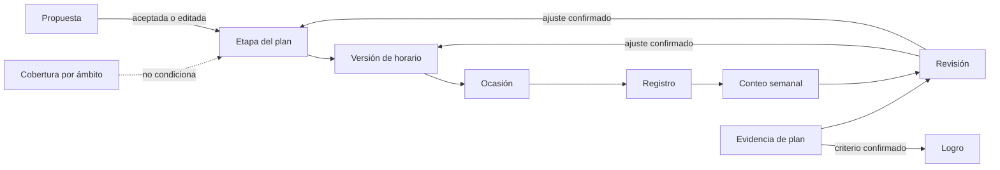
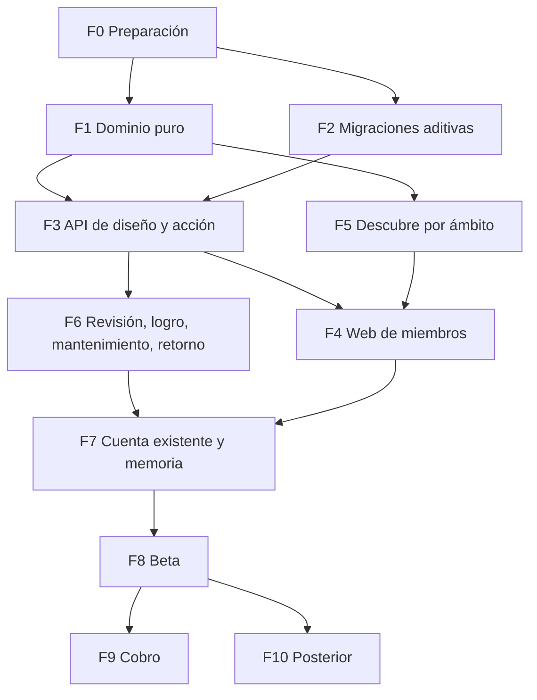

# Plan maestro de implementación: recorrido por ámbitos

21 oct 2026. Documento de planificación. Integra el hilo del propósito (para qué de cada plan, sin puerta de entrada). Nada ejecutado salvo lo registrado en `MK_IMPLEMENTATION_PROGRESS.md`. No autoriza migrar, desplegar ni cambiar copy público fuera de lo previsto. Traduce [PLAN_MAESTRO_RECORRIDO.md](PLAN_MAESTRO_RECORRIDO.md) (dirección de producto, sin firma) a cambios concretos sobre el código de la rama `pilot/ikigai-lista`, commit `0e72f69`, que también está en `origin/dev`.

17 oct 2026: la experiencia de cada pantalla, la navegación, las interacciones, el copy y los datos de referencia están en [MK_ESPECIFICACION_UI_UX.md](MK_ESPECIFICACION_UI_UX.md), que es la autoridad de implementación de las pantallas. Donde la sección E o las tareas de F4 de este documento difieren de ella, manda la especificación. Los cambios derivados se listan en la sección K.

## 0. Cómo leer este documento

Marcas de evidencia usadas en todo el texto:

- **[C]** Comportamiento comprobado leyendo el código en este checkout. Cita archivo y, cuando ayuda, líneas.
- **[D]** Descrito en un documento del repositorio y no comprobado en código o en un entorno.
- **[P]** Cambio propuesto por este plan.
- **[?]** Decisión pendiente. Las de producto llevan recomendación en la sección I.

Archivos existentes se citan con su ruta. Archivos que este plan propone crear se marcan **(nuevo)**. Ningún endpoint, tabla o archivo marcado como existente se infirió del nombre: todos se leyeron.

Autoridad, en este orden: el plan del 16 oct para la dirección de producto; el código para lo que existe; `DESIGN.md` y `.cursor/rules/*` para UI, copy y la congelación de Matrix v2; los documentos anteriores (`RECORDATORIO_ENTRADA_Y_AVANCE.md`, `MK_producto_recorrido_completo.md`, `MK_IMPLEMENTATION_PROGRESS.md`, `docs/phase-2/*`) solo como antecedente. Cuando un documento anterior contradice el plan del 16 oct, manda el plan y la contradicción se lista en 0.3.

### 0.1 Estado de git y trabajo local que no se debe pisar

[C] Rama `pilot/ikigai-lista`, sin upstream configurado. `HEAD` (`0e72f69`) está contenido en `origin/dev` y 7 commits por delante de `origin/main`. Hay cambios sin commitear de otra sesión (player y auth), entre otros:

- `apps/api/src/diagnostic/diagnostic.service.ts`, `diagnostic.controller.ts`, `question-capture.ts`, `player-navigation.ts` (nuevo).
- `apps/web/components/diagnostico/*` (p. ej. `DiagnosticPlayer.tsx`, `ModuleOutro.tsx`, `AreaSectionsRail.tsx`, `AuditCloseScreen.tsx`, `player-back.ts`).
- `apps/web/app/globals.css`, `apps/web/lib/api.ts`, `packages/database/definitions/formulario-completo@6.json`.
- Documentos de planificación sin versionar: `PLAN_MAESTRO_RECORRIDO.md`, `MK_PLAN_MAESTRO_IMPLEMENTACION.md`, `MK_ESPECIFICACION_UI_UX.md`, `RECORDATORIO_ENTRADA_Y_AVANCE.md`, `tmp/**`, `test-results/.last-run.json`.

Regla para quien ejecute: F1 (dominio puro) no toca esos archivos. F5 (T5.1, T5.2) no empieza hasta que el trabajo del player esté commiteado o descartado por su dueño, porque modifica `diagnostic.service.ts`. Trabajar en una rama nueva desde `origin/dev` cuando se integre código de producto; no hacer `git add -A`. Cada entrega agrega solo sus archivos.

### 0.2 Hallazgos que condicionan todo el plan

1. [C] Las pantallas operativas de miembros no están montadas. `apps/web/app/(member)/{planes,calendario,proposito,ruta,mente,espiritu,cuerpo,asesores}/page.tsx` renderizan `ComingSoon`. `PlansScreen`, `CalendarScreen`, `PurposeScreen`, `AmbitTasks` y `AccompanimentFlow` existen en `apps/web/components/journey/` y solo los importan pruebas (`apps/web/test/journey-followup.test.tsx`, `accompaniment-flow.test.tsx`). `AmbitStage.tsx:18` oculta esos enlaces (`HIDDEN_HREFS`). En staging, una persona ve Inicio, Perfil, Cuenta y el player.
2. [C] El servidor exige el cuestionario completo y una dirección antes de escribir cualquier plan o acción: `writerBlock` en `apps/api/src/journey/plan-gate.ts:22-38`, llamado por `createPlan`, `patchPlan`, `addAction`, `addDomainAction` y por `AccompanimentService.store` (`accompaniment.service.ts:542-545`). Esto contradice la entrada directa al dashboard y el plan genérico.
3. [C] Una cuenta nueva aterriza en `/diagnostico`, no en el dashboard: `getPostAuthPath` en `apps/web/lib/auth-redirect.ts:11-18` envía `TERMS_PENDING` (valor por defecto de `User.onboardingStep`, `schema.prisma:27`) al cuestionario.
4. [C] Hay dos porcentajes semanales y ninguno cumple la semántica del plan nuevo. `executionReading` (`apps/api/src/journey/execution.ts:90-113`) cuenta acciones con al menos un `DONE` sobre acciones activas. `occasionTally` (`execution.ts:30-87`) devuelve `done / valid`, donde `valid` incluye ocasiones sin información y futuras, y saca las cancelaciones del denominador.
5. [C] Las ocasiones no tienen historia propia. Se calculan con el `weekday` e `intervalDays` actuales de la acción (`futureOccasions`, `apply-week.ts:190-199`; `occasionGuidance`, `journey.service.ts:1448-1464`). Una revisión que cambia el día (`MODIFY`, `REDUCE`) reescribe en el lugar `plan_actions.weekday` (`closeWeek`, `journey.service.ts:1313-1326`), así que una semana abierta anterior se recalcula con el día nuevo.
6. [C] Las lecturas que alimentan las propuestas solo existen con el cuestionario completo. `AccompanimentService.accountTexts` y `health` (`accompaniment.service.ts:501-539`) leen solo sesiones `COMPLETED`, y `build` toma las señales de `CoreReading` `ia-mk-cuest@0.1` (`:322`), que se materializa al cerrar el cuestionario entero (`completeDiagnostic`, `diagnostic.service.ts:785-864`). Con respuestas parciales, MK no puede usar ninguna.
7. [C] El motor de propuestas ya existe y sigue el patrón vista previa y confirmación: `proposeAccompaniment` (`accompaniment/rules.ts:262`), familias con acción, versión mínima, evidencia esperada y alternativa (`accompaniment/families.ts`), inventario de fuentes con usos permitidos y prohibidos (`accompaniment/sources.ts:18`), devolución con observaciones por reconocer (`accompaniment/devolution.ts:59`), digest, `commandKey` por cuenta y bloqueo consultivo. El plan nuevo se apoya en esto. No hace falta un modelo generativo para la primera versión.
8. [C] El cobro no existe. `SubscriptionGuard` devuelve siempre `true` (`apps/api/src/auth/subscription.guard.ts:5-8`). No hay cliente, webhook ni variable de Mercado Pago. `EARLY_ACCESS_MODE = true` es una constante en `apps/api/src/product-phase.ts:8` y `apps/web/lib/product-phase.ts:8`. Cualquier cuenta autenticada tiene `canUseMemberProduct` (`member-access.ts:23-32`).
9. [C] El vínculo plan y dirección ya existe en el modelo (`PersonalPlan.linkKind`, `valueRef`, `purposeRevisionId` en `schema.prisma`), pero `createPlan` exige hoy `linkKind` (`journey.service.ts:724`) y todo pasa por `writerBlock`, que exige cuestionario completo y dirección (`plan-gate.ts:22-38`). No hay revisión del para qué ni del vínculo en la experiencia nueva.

### 0.3 Contradicciones entre fuentes

| Contradicción | Fuentes | Consecuencia | Tratamiento |
|---|---|---|---|
| Catálogo de referencia | El plan cita `formulario-completo@5`. [C] `ensureFormularioCompleto` activa la revisión más alta, `@6` (`packages/database/src/formulario-completo.ts:149-153,194-198`). `MK_IMPLEMENTATION_PROGRESS.md` (13 oct) dice que las sesiones nuevas usan `@6`. | [C] `@5` y `@6` tienen los mismos 31 módulos, 239 preguntas y las mismas referencias de fila. `@6` repara etiquetas. El corte por ámbito no cambia. | El mapa de ámbitos se define por `sourceRef`, no por versión, y se prueba contra `@2` a `@6`. Falta verificar qué revisión está activa en staging (T0.2). |
| Quién escribe el plan | `docs/phase-2/LENGUAJE.md` fija como frase canónica «la persona escribe el plan» (default D9 sin firma) y «Rafa escribe. La IA no redacta» (D3). El plan del 16 oct dice que MK propone criterio, paso y mantenimiento. [C] D3 y D9 no aparecen en `docs/phase-2/MK_DECISIONS.md`. | Si D9 siguiera vigente, la corrección A del plan no podría implementarse. | El plan nuevo reemplaza D9. Las propuestas salen de plantillas y reglas versionadas, no de texto generado, lo que es compatible con D3. Hay que actualizar `LENGUAJE.md` en la entrega de copy. |
| Nombres canónicos | `LENGUAJE.md:119` lista como nombres de la web Perfil Maestro, Índice de Alineación, Hoja de Ruta, Espíritu, Mente, Cuerpo. | Contradice la nueva experiencia. | Se actualiza `LENGUAJE.md` al aplicar copy (T8.1). Hasta entonces el léxico nuevo vive en este documento. |
| Inicio de miembros | `DESIGN.md` («Inicio de miembros») define la escena de estatua con tres métricas de pilar y la placa del índice. | El dashboard nuevo no muestra pilares ni índice. | `DESIGN.md` se actualiza en el mismo cambio que el dashboard (T4.2). La referencia visual de cuatro ámbitos queda como decisión [?] D-UI. |
| Celdas de ámbito existentes | [C] `instrumentos/territory-map.ts:21-38` asigna señales a ámbitos cruzados con pilares, incluidas `R66` y `R67` de `e-aud-s6` en Relaciones. El plan deja `e-aud-s6` fuera del puntaje y fuera de las cuatro filas. | Dos mapas distintos de «qué pregunta es de qué ámbito». | `territoryMap` queda solo para la lectura histórica del índice. La cobertura nueva usa un catálogo de ámbito propio (T1.1). |
| Prueba e2e del dashboard | [C] `e2e/dashboard-ambitos.spec.ts` espera tres métricas de pilar y tareas en `/mente` y `/calendario`, que hoy son `ComingSoon`. | La prueba está desactualizada respecto del árbol actual. | Se reescribe para el dashboard nuevo (T4.7). |
| Recorrido del 7 oct | `MK_producto_recorrido_completo.md` propone ocho momentos y «manifiesto firmado» con función propia. | El plan nuevo quita la hoja de ruta como recorrido. | Se conserva el documento firmado existente como historial (sección F). No se ofrece firmar en la experiencia nueva salvo decisión D-PROP. |
| Especificaciones anteriores con la columna vertebral vieja | [D] `MK_PROMPT_DASHBOARD_AMBITOS.md` (30 sep, tres ámbitos Mente, Espíritu, Cuerpo y placa de índice), `MK_PROMPT_MAESTRO_RECORRIDO.md` (30 sep, cuestionario, Perfil Maestro, hoja), `MK_recorrido_cuenta.md`, `MK_como_funciona.md`, `MK_producto_proposito_alineacion.md` (cuestionario completo obligatorio antes del primer plan), `PERFIL_MAESTRO.md`, `docs/phase-2/MK_PRODUCT_ENGINE.md` | Un agente que los lea como vigentes restauraría pilares, índice y cuestionario como puerta | Se marcan como antecedente en su primera línea en T8.1. Mientras tanto, este documento manda sobre ellos |
| Firma de decisiones | [D] `docs/phase-2/MK_DECISIONS.md` (14 ago) solo tiene D12 firmada. El plan del 16 oct tampoco está firmado | Retirar índice y Perfil Maestro de la interfaz no tiene un DECIDIDO | No bloquea F1 a F7 porque no se borra ni cambia ningún cálculo. Sí conviene que Rafa confirme antes de beta (D-COPY) |
| Propósito «Es opcional» (S-14) frente al hilo del 21 oct | [MK_ESPECIFICACION_UI_UX.md](MK_ESPECIFICACION_UI_UX.md) y este plan antes del 21 oct trataban Propósito como recurso aparte | Los planes deben orientarse por un para qué sin bloquear la entrada | [P] El propósito de cuenta orienta; el para qué del plan es obligatorio en sentido de producto pero no en `activationBlock`. Copy en S-14 y Diseña (T4, T8.1) |

## A. Inventario y análisis de brechas

Tratamiento: **Conservar** (sirve sin cambios), **Adaptar** (se modifica), **Sustituir** (se reemplaza por otra pieza), **Retirar de la navegación** (el código y los datos quedan, la persona no llega), **Fuera** (no entra en esta entrega).

### A.1 Tabla de capacidades

| Capacidad | Estado actual y evidencia | Objetivo | Brecha | Archivos y símbolos | Dependencias | Tratamiento |
|---|---|---|---|---|---|---|
| Registro, login, sesión | [C] JWT de 15 min, refresh opaco rotado en transacción, cookie `mk_refresh`, contrato nativo por `X-MK-Client`. `auth.controller.ts:49-143`, `auth.service.ts:54-267`. Sin verificación de correo. | Igual | Ninguna funcional | `apps/api/src/auth/*`, `apps/web/lib/api.ts:100-176`, `resolve-session.ts` | Ninguna | Conservar |
| Destino tras registro | [C] `/diagnostico` para `TERMS_PENDING` (`auth-redirect.ts:11-18`). `/bienvenido` siempre a `/panel`. | Siempre `/panel` para miembros | Cambiar la regla | `apps/web/lib/auth-redirect.ts`, `apps/web/test/member-access.test.ts:43-50` | Dashboard nuevo (T4.2) | Adaptar |
| Correo de bienvenida | [C] Promete diagnóstico, Perfil Maestro y Ruta al lanzar (`mail/email-templates.ts:240`). | Describe el producto real | Copy | `apps/api/src/mail/email-templates.ts` | Decisión D-COPY | Adaptar en beta |
| Recordatorio de cuestionario | [C] Cron cada 4 h (`diagnostic/reengagement.service.ts:28-30`), apagado mientras `EARLY_ACCESS_MODE`. Texto «Diagnóstico Maestro», «Perfil Maestro». | El cuestionario incompleto es normal. No hay deuda. | Se activaría al abrir el producto | `reengagement.service.ts`, `email-templates.ts:276-332` | Ninguna | Retirar (desactivar el cron) |
| Dashboard | [C] `/panel` → `InicioDashboard` → `AmbitStage`: escena de estatua, tres métricas Mente/Espíritu/Cuerpo, placa «Índice de alineación MK» (`AmbitStage.tsx:12-16,186-189`). Datos de `GET /journey/state`. | Cuatro ámbitos por tres fases, foco, qué toca ahora, decisión pendiente, logros | Pantalla y contrato nuevos | `components/pages/InicioDashboard.tsx`, `components/journey/AmbitStage.tsx`, `HomeReading.tsx`, `journey/home-board.ts`, `journey.service.ts:256-361` | Estados de plan, conteos | Sustituir |
| Navegación | [C] Sidebar con Inicio, Espíritu, Mente, Cuerpo, Ruta, Calendario, Planes, Propósito, Perfil, Asesores, Cuenta (`MemberSideNav.tsx:8-20`). Barra inferior Inicio, Ruta, Perfil y Más (`BottomTabBar.tsx`). | Inicio, Semana, Planes, Propósito, Memoria, Cuenta | Cambiar enlaces y redirecciones | `components/app-shell/*` | Rutas nuevas | Adaptar |
| Páginas por pilar | [C] `ComingSoon`. `GET /journey/domains/:domain`, `POST .../actions` activos. | No existen pilares | Retirar | `(member)/{mente,espiritu,cuerpo}/page.tsx`, `AmbitTasks.tsx`, `journey.controller.ts:88-100` | Ninguna | Retirar de la navegación, redirigir a `/panel`. Endpoints quedan hasta T8.6 |
| Página por ámbito | No existe | Descubre, Diseña y Actúa de un ámbito | Crear | `app/(member)/ambito/[territory]/page.tsx` (nuevo) | T3, T5 | Crear |
| Catálogo y player | [C] `DiagnosticVersion`, módulos, preguntas con `sourceRef`, excepciones `UNKNOWN`, `NOT_APPLICABLE`, `DECLINED`, `PENDING`, revisiones con conflicto 409, retoma, guardar y salir. Desbloqueo secuencial: primer módulo `AVAILABLE`, resto `LOCKED` (`diagnostic.service.ts:140-150`), siguiente se abre en `markOutroSeen`. | Cuestionario opcional por ámbito, en cualquier orden, y preguntas puntuales | Desbloqueo por ámbito y modo de pregunta suelta | `diagnostic.service.ts`, `diagnostic.controller.ts`, `components/diagnostico/*` | Catálogo de ámbito (T1.1) | Adaptar |
| Cierre del cuestionario | [C] `completeDiagnostic` crea `MasterProfile`, `DiagnosticFormResult` `formulario-score@1`, `CoreReading` `INITIAL` y alertas cuando todos los módulos están cerrados. | El cálculo histórico sigue. La persona no ve índice ni perfil. | Ninguna en servidor | `diagnostic.service.ts:785-864`, `instrumentos/reading.ts`, `core-reading.ts:60-90` | Ninguna | Conservar el cálculo, retirar la pantalla |
| Cobertura | [C] `completionPct` usa todas las preguntas del catálogo (`diagnostic.service.ts:1001-1007`). Módulo cerrado cuando todas sus preguntas están resueltas, incluidas las omitidas por condición. No hay cobertura por ámbito. | Cobertura por ámbito con excepciones y sin denominadores imposibles | Cálculo nuevo | `instrumentos/territory-catalog.ts` (nuevo), `instrumentos/answer-ledger.ts` (nuevo) | Catálogo de ámbito | Crear |
| Síntesis de Descubre | [C] `devolutionOf` arma observaciones con estado `POR_RECONOCER`, `RECONOCIDO`, `RECHAZADO` a partir de textos de visión, valor y estándar (`accompaniment/devolution.ts`). Solo con cuestionario completo. Lectura de cierre de módulo `moduleReading` (`excel-score.ts`). | Síntesis breve por tramo, corregible, con procedencia | Reglas por ámbito, lectura de respuestas parciales | `accompaniment/devolution.ts`, `accompaniment/sources.ts`, `discover-synthesis.ts` (nuevo) | Fuente por instrumento (D-SRC), textos de Rafa (D-SYN) | Adaptar |
| Índice de Alineación, profundidad, ficha IAD | [C] `ia-mk-cuest@0.1` (`core-index.ts`, `core-reading.ts`), `profundidad-mk@0.1` (`depth.ts`), IAD-MK 0.1 (`iad.ts`, `POST /journey/alignment`). Se muestran en Inicio, Perfil y en pantallas no montadas. | No se muestran | UI | `AmbitStage.tsx`, `IndexSummary.tsx`, `PerfilContent.tsx`, `profile/*` | Ninguna | Retirar de la interfaz. Cálculos y filas se conservan |
| Perfil Maestro | [C] `MasterProfile` por sesión, `isCurrent`. `/perfil` → `PerfilContent`, `ExcelProfile`, `SystemReport`. | No se muestra como perfil. La persona recupera lo que dijo. | Vista de memoria | `(member)/perfil/page.tsx`, `components/pages/PerfilContent.tsx` | Memoria (T7.1) | Sustituir por la memoria. Lo existente queda como lectura histórica |
| Hoja de Ruta y firma | [C] `PurposeRevision` con `confirmedAt` y `content.contract` congelado (`journey.service.ts:406-504`). Firma en `/diagnostico/resultado` (`RoadmapClose.tsx`). La firma exige el cuestionario completo (`hdrpGaps`). | Sin hoja para completar. Los documentos firmados se conservan | Retirar el flujo de firma, conservar lectura | `RoadmapClose.tsx`, `journey/hdrp-contract.ts`, `(member)/diagnostico/resultado/page.tsx` | D-PROP | Retirar de la navegación. Lectura en memoria |
| Propósito e IKIGAI de cuenta | [C] Síntesis de actividades y cruce (`purpose-synthesis.ts`, `IkigaiCross.tsx`, `GET/POST /journey/synthesis`), estado de dirección `EXPLORANDO`, `PROVISIONAL`, `CONFIRMADO_POR_USUARIO`. `PurposeScreen` no montada. | Orienta planes; no es puerta. Semilla `EXPLORANDO` solo si la persona acepta tras activar un plan con para qué confirmado | Montar sin bloqueo ni índice; mostrar planes vinculados | `PurposeScreen.tsx`, `IkigaiCross.tsx`, `journey.service.ts:620-695`, `purpose-link.ts` (nuevo) | T1.7, T3.9 | Adaptar |
| Para qué del plan | [C] `why_it_matters` previsto en M1 pero sin flujo. `linkKind` y `purposeRevisionId` se escriben al crear, no al confirmar vínculo | Frase por plan con estado (`PROPOSED`, `CONFIRMED`, `PROVISIONAL`), procedencia (`why_refs`), vínculo con dirección (`link_status`) | Propuesta en Diseña, lectura en revisión (`PURPOSE_DRIFT`), campo en logro | `purpose-link.ts`, M1, S-06, S-08 | T1.7, T3.4, T6.1 | Crear |
| IKIGAI público | [C] Sesiones anónimas con token (`apps/api/src/ikigai/*`, `packages/ikigai-engine`), sin `userId`. | Sin cambio | Ninguna | | | Fuera |
| Desarrollo y sentido (`e-aud-s6`) | [C] `scoreSense` suma /50 sin bandas, fuera de las 115 (`instrumentos/score.ts:91-95`). Se ve en `ExcelProfile`. | Lectura aparte en Propósito, lugar por precisar | Ubicación | `score.ts`, `ExcelProfile.tsx:239-245` | D-S6 | Adaptar después de D-S6 |
| Propuesta inicial de plan | [C] `POST /journey/accompaniment/preview` y `POST /journey/accompaniment` con digest, `headVersion`, `commandKey`, `planChoice` KEEP/MODIFY/REPLACE, incompatibilidad y alternativa. Al aceptar crea plan `ACTIVE` y una acción `SYSTEM_TEMPLATE`. | MK propone meta, paso, criterio y para qué (con procedencia); la persona acepta, edita o descarta; nada se activa sin confirmación | Crear en preparación, no activo. Quitar `writerBlock`. Para qué no bloquea activación | `journey/accompaniment.service.ts`, `accompaniment/*`, `purpose-link.ts`, `AccompanimentFlow.tsx` | Estados de plan (T2.1), T1.7 | Adaptar |
| Criterio de logro | [C] Por acción: `PlanAction.doneWhen`. Por plan: `PersonalPlan.outcome`, texto libre, se puede cambiar en la revisión (`nextPlanOutcome`). No hay estado propuesto/confirmado. | Criterio observable de la meta, propuesto, confirmado o provisional | Campos y propuesta | `schema.prisma:1035-1057`, `apply-week.ts:183-188` | T2.1, T2.3 | Adaptar |
| Clase de objetivo | No existe. `GoalKind` describe el tipo de meta (`vocab.ts:21-31`), no cómo termina. | Proyecto, práctica, experimento, condicionado por otros | Campo y reglas de cierre | `plan-lifecycle.ts` (nuevo) | T2.1 | Crear |
| Plan propio | [C] `createPlan` y `addAction` escriben lo que la persona trae, con la puerta de cuestionario. No hay ayuda para ordenar ocasión, criterio y horizonte. | MK ordena lo que trae y propone lo que falta | Vista previa de plan propio | `journey.service.ts:712-1030`, `own-plan.ts` (nuevo) | T2, T3 | Adaptar |
| Estados del plan | [C] `DRAFT`, `ACTIVE`, `PAUSED`, `ARCHIVED` (`schema.prisma:997-1002`). `createPlan` pausa el plan activo anterior. `PATCH` no acepta `PAUSED`. | En preparación, activo, en pausa, en mantenimiento, cerrado; logro aparte | Etapa nueva, transiciones con historia | `schema.prisma`, `journey.service.ts:712-912` | Migración M1 | Adaptar |
| Foco | [C] Implícito: el único plan `ACTIVE`. `AccompanimentHead` apunta a la decisión principal. | Un foco explícito; planes secundarios y en mantenimiento cuentan en la carga | Marca de foco | M1 | T2.1 | Crear |
| Ocasiones y calendario | [C] Calculadas al vuelo desde el estado actual de la acción; horizonte de 21 días; `GET /journey/calendar`. | Ocasiones estables en el pasado; cambios de frecuencia solo hacia adelante | Versiones de horario | `apply-week.ts:190-199`, `journey.service.ts:1156-1172`, `action-schedule.ts` (nuevo) | M2 | Adaptar |
| Registro de ocasión | [C] `POST /journey/records` hace upsert por `(actionId, day)`, bloquea semanas cerradas, impide pasar de hecho a no aplica. No comprueba que el día sea una ocasión, ni que no sea futuro, ni revisión concurrente (`journey.service.ts:1174-1209`). | Hecha, no hecha, sin información, con resultado opcional; escrituras seguras | Validaciones y revisión | `journey.service.ts`, M4 | T1.2 | Adaptar |
| Excepciones | [C] `OccasionCancellation` con motivo, única por `(actionId, day)`, no permite cancelar una hecha (`accompaniment.service.ts:143-169`). Sale del denominador. | Excepción visible con motivo; con excepciones no hay porcentaje | Cambiar el conteo | `execution.ts`, `week-count.ts` (nuevo) | T1.2 | Adaptar |
| Conteo semanal | Ver 0.2 punto 4 | Semántica única (C.4) | Reemplazar | `execution.ts`, `review-guidance.ts:74-113` | T1.2 | Sustituir |
| Resultado observado | [C] Por ocasión: `ActionRecord.resultStatus` (`OBSERVED`, `NOT_YET_OBSERVED`, `NOT_OBSERVED`, `NO_INFORMATION`) y `resultNote`. Experimentos: `ExperimentObservation` con aspecto y respuesta de destinatario. | Evidencia de plan contra el criterio, también con ejecución parcial | Evidencia de plan | `schema.prisma:1100-1115,1329-1345`, M3 | T2.3 | Adaptar |
| Revisión semanal | [C] Vista previa y cierre con decisiones por acción `KEEP`, `REDUCE`, `SUBSTITUTE`, `PAUSE`, `RESUME`, `CLOSE`, `MODIFY`, `RETIRE`; snapshot; digest; un cierre por semana; 409 ante comando distinto; transacción probada con fallo inyectado (`journey.service.ts:1211-1364`). Ayuda por umbrales 0,4 y 0,7 sin horizonte (`review-guidance.ts`). | Lectura con horizonte, evidencia, carga y contexto; ajuste explicado con fecha efectiva | Lectura nueva y registro del ajuste | `review-guidance.ts`, `apply-week.ts`, `review-reading.ts` (nuevo) | T1.3, T2.2 | Adaptar |
| Logro, mantenimiento, retorno | [C] Modo `CONSOLIDACION` en las reglas. `contextReview` invita después de 14 días sin registro (`journey.service.ts:1437-1446`). Situaciones `PAUSE` y `RETURN` en acompañamiento recuperan la última meta. No hay logro ni mantenimiento como estado. | Logro confirmado contra criterio, mantenimiento propuesto, retorno sin deuda | Estados, propuestas y pantalla | `accompaniment/rules.ts`, `journey.service.ts` | T2, T6 | Adaptar |
| Restricciones y salud | [C] Marcas de contenido declaradas, `decideAction`, aclaraciones fechadas en `MemberClarification`, salud desconocida pide aclaración (`instrumentos/restrictions.ts:41-81`, `plan-gate.ts:127-181`). Lee F-RAD-001 solo de sesiones cerradas. | Igual, también sin cuestionario | Leer respuestas parciales | `accompaniment.service.ts:527-539`, `answer-ledger.ts` (nuevo) | T1.4 | Adaptar |
| Admin y alertas | [C] `QuestionnaireAlert` por cuenta, `AdminActorGuard` lee el rol en base en cada petición, `withoutInternalAlerts` limpia el JSON de miembro, `AdminAccessLog` (`admin/member-journey.*`, `admin/public-reading.ts`). | Igual; ver estados nuevos | Mostrar etapa, foco y criterio en el recorrido de admin | `admin/member-journey.service.ts`, `components/admin/recorrido-view.tsx` | T2 | Adaptar en beta |
| Lab, Matrix v2, Direction | [C] Solo Lab; `instrumentos-isolation.test.ts` prueba que el recorrido de miembro no importa motores de Matrix. | Sin cambio (regla `matrix-v2-frozen`) | Ninguna | `apps/api/src/lab`, `packages/matrix-engine`, `packages/experience-engine` | | Fuera |
| Cobro | Ver 0.2 punto 8. Planes y días de prueba editables (`billing/*`, `/admin/planes`). | Suscripción con Mercado Pago, permisos, prueba | Todo | `billing/*`, `auth/subscription.guard.ts`, `schema.prisma:51-95` | D-COBRO | Fase 9 |
| Promesas públicas | [C] `landing-copy.ts:75,90-100,206,267-271` («De la auditoría a la ejecución», Diagnóstico inicial, Hoja de Ruta, pilares, «Panel e índices»); `sistema-content.tsx:38-49` (Índice de Alineación MK); `marco-central`, `manifiesto`, `precios-faq.ts`, `landing-faq.ts`, `llms.txt/route.ts:22,43`; beneficios sembrados en `plans.benefits` (`seed.ts:42-46`). | Una promesa que coincide con lo que recibe la cuenta | Decisión de copy | ver sección E.6 | D-COPY | Decidir antes de beta; alinear antes de cobrar |
| Pruebas | [C] Dominio (`npm run test:domain -w @mk/api`), componentes jsdom (`npm run test:components -w @mk/web`), HTTP sobre base desechable `mk_journey_it` (`scripts/test-acceptance.sh`, `apps/api/test/journey-http-app.ts`). CI (`.github/workflows/ci.yml`) corre en `main`/`master`, sin Playwright. | Cubrir los contratos nuevos con dominio, componentes y HTTP | Pruebas nuevas | `apps/api/test/*`, `apps/web/test/*` | Cada tarea | Adaptar |
| Despliegue | [C] Railway, dos servicios. La API migra al arrancar (`scripts/start-api.sh:15-16`, `apps/api/railway.toml`). La web no migra. Sin orden entre servicios. | Orden API antes que web; migraciones aditivas | Procedimiento | `railway.*.toml`, `scripts/start-api.sh` | Sección F | Conservar con procedimiento |

### A.2 Superficies de miembro

| Ruta | Hoy [C] | Tratamiento [P] |
|---|---|---|
| `/panel` | `AmbitStage` | Sustituir por el dashboard de ámbitos |
| `/ambito/[territory]` | No existe | Crear |
| `/planes` | `ComingSoon` | Montar la lista de planes (foco, secundarios, en mantenimiento, en pausa, cerrados) |
| `/planes/[planId]` | No existe | Crear: detalle de plan con Diseña y Actúa |
| `/calendario` | `ComingSoon` | Redirigir a `/semana` (nueva), que adapta `CalendarScreen`. Rutas completas en la especificación UI/UX, 2.2 |
| `/proposito` | `ComingSoon` | Montar `PurposeScreen` sin índice ni ficha IAD |
| `/memoria` | No existe | Crear: logros, aprendizajes, decisiones, documentos y lecturas anteriores |
| `/perfil` | `PerfilContent` | Redirigir a `/memoria?vista=documentos`. Conservar componentes para la lectura histórica |
| `/diagnostico/resultado` | `RoadmapClose` | Redirigir a `/memoria?vista=documentos`. Quien tenga un borrador sin firmar lo ve ahí en solo lectura |
| `/ruta`, `/mente`, `/espiritu`, `/cuerpo`, `/asesores` | `ComingSoon` | Redirigir a `/panel` |
| `/cuenta` | `CuentaContent` | Conservar. Quitar «Miembro Fundador» cuando cambie el copy |
| `/diagnostico/*` | Player | Adaptar: entrada por ámbito y pregunta suelta |

## B. Recorridos completos

Notación de cada paso: **Ve**, **Puede**, **MK propone**, **Usa**, **Guarda**, **Transición**, **Si falta, rechaza o falla**. Los endpoints con **(nuevo)** se especifican en C.9.

### B.0 Común a las tres entradas

| Paso | Detalle |
|---|---|
| 1. Registro | **Ve** el formulario actual. **Guarda** `User`, `Subscription` `TRIAL` sin `trialEnd` [C]. **Transición** `/panel` (T4.1). **Falla**: error de formulario conservando lo escrito [C]. |
| 2. Dashboard vacío | **Ve** los cuatro ámbitos con su fase en «sin empezar», sin porcentajes ni índice, y la pregunta «¿Por dónde quieres empezar?» con tres entradas. **Puede** elegir ámbito y entrada, o abrir Propósito. **MK propone** nada todavía. **Usa** `GET /journey/dashboard` (nuevo). **Guarda** nada. **Falla**: estado de error con reintento, sin pintar ceros. |
| 3. Elegir ámbito | **Transición** `/ambito/[territory]` con la entrada elegida. Si no elige ámbito porque no sabe qué quiere cambiar, la entrada 1 permite elegirlo después de la exploración. |

### B.1 Entrada «No sé qué quiero cambiar»

| Paso | Ve / puede | MK propone | Usa | Guarda | Transición | Faltante, rechazo, fallo |
|---|---|---|---|---|---|---|
| 1. Situación | Una pregunta: qué situación concreta quisiera que fuera distinta, en qué ámbito si lo sabe | Nada | Texto libre | Borrador local en el navegador hasta enviar | Vista previa | Si no escribe nada, puede abrir Propósito o una prueba pequeña sin situación |
| 2. Exploración propuesta | Una prueba pequeña con su motivo, su pregunta de aprendizaje y cuándo se mira | Experimento: familia de exploración del ámbito o `X-IKIGAI` si viene de Propósito, versión mínima, pregunta de aprendizaje, horizonte por defecto | Situación, ámbito, respuestas del ámbito si existen (ledger), aclaraciones previas, restricciones | Nada hasta confirmar. Vista previa con digest | Aceptar, editar o descartar | Descartar: MK ofrece otra prueba o la opción de quedarse en Propósito. Si no hay plantilla para ese ámbito, se dice y se ofrece escribirla. Sin datos de salud y prueba física: aclaración antes de activar |
| 3. Preguntas que cambian la prueba | Hasta tres preguntas puntuales del ámbito, solo si cambian la prueba, con el motivo | La pregunta y qué cambiaría | Catálogo de ámbito, reglas de pertinencia | `Response` en la sesión activa | Vuelve a la vista previa | Responder «no sé», «no aplica» o «prefiero no responder» es válido. La pregunta no vuelve a pedirse para llenar cobertura |
| 3b. Para qué (opcional) | Campo «¿Para qué te importa esto?» con propuesta de MK si hay fuentes | Frase de para qué y, si hay dirección, `linkKind` con motivo | Meta, dirección, valor, visión, huella, IKIGAI (`SOURCE_INVENTORY`, no `NOT_CONNECTED`) | `why_it_matters`, `why_status`, `why_refs`, `linkKind`/`link_status`/`purposeRevisionId` solo al confirmar vínculo | Vista previa | Descartar deja `PROVISIONAL`; no bloquea activación |
| 4. Activar | Resumen: qué se prueba, cuándo, qué se protege, cuándo se revisa, para qué (confirmado o provisional) | Horizonte y señal | Lo anterior | Plan en preparación, `PlanProposal` aceptadas, transición a activo, versión de horario, experimento (`IkigaiExperiment` y su revisión) | Plan activo y foco | Si falta tiempo o restricciones, el botón explica qué falta. 409 si el plan cambió en otra pestaña. Tras activar, tarjeta de semilla de dirección si no hay dirección de trabajo y el para qué está confirmado |
| 5. Semana | Conteos de hechas, vencidas sin marcar y próximas. Marcar hecha, no hecha, anotar resultado | Nada | Ocasiones | `ActionRecord` | | Fallo de guardado conserva el estado elegido y permite reintentar |
| 6. Primera revisión | Lectura con horizonte: si todavía es pronto, se dice. Observaciones del experimento | Mantener, aclarar o revisar la hipótesis | `review-reading@1`, observaciones | `WeekReview` con lectura y ajustes | Semana siguiente | Sin registros: recuperar información antes de concluir |
| 7. Cierre del experimento | Qué se aprendió. Descartar la hipótesis con evidencia es un resultado | Cerrar con aprendizaje, cambiar hipótesis o pasar a una meta | `ExperimentReview` | Revisión del experimento, transición a cerrado con motivo `LEARNED` | Elegir: terminar, meta nueva (entrada 2), Propósito | |
| 8. Retorno | Ver B.4 | | | | | |

### B.2 Entrada «Tengo una meta»

| Paso | Ve / puede | MK propone | Usa | Guarda | Transición | Faltante, rechazo, fallo |
|---|---|---|---|---|---|---|
| 1. Meta | Escribir la meta. Elegir clase si la reconoce (proyecto, práctica, condicionado por otros) o dejar que MK la proponga | Clase de objetivo | `declarationToGoal`, texto | Nada | | |
| 2. Tiempo y restricciones | Ocasiones por semana o minutos, qué debe proteger, si algo limita | Nada | | Nada | | «No sé» en tiempo bloquea la activación y lo dice. Restricción declarada se guarda al confirmar |
| 3. Paso, criterio y para qué | Un paso con su versión mínima, criterio observable, para qué propuesto (fila en `ProposalSummary`) y motivo de cada uno | Acción, mínimo, criterio, para qué, `linkKind` si hay dirección | Familia por ámbito, barreras reconocidas, ledger, fuentes de propósito | Nada hasta confirmar | Aceptar, editar o descartar cada parte | Para qué vacío: activación permitida con `PROVISIONAL`. P4 prellena «¿Por qué este paso te acerca…?» con el para qué confirmado |
| 4. Personalización | Si una respuesta existente tiene relación explicable: «Señalaste X. ¿Eso ocurre con este proyecto?» | Cambio de estrategia, carga u orden, con la fuente | `SOURCE_INVENTORY`, respuestas | `MemberClarification` con el reconocimiento o rechazo | Vista previa recalculada | Rechazo: esa respuesta deja de orientar este plan y no vuelve a proponerse con la misma revisión de respuesta |
| 5. Tres preguntas antes de activar | Por qué acercaría, si cabe, qué proteger | | | Expectativa del paso en el plan | | |
| 6. Activar | Igual que B.1 paso 4 | | | | Plan activo y foco | |
| 7. Semana y revisión | Igual que B.1 | Antes del horizonte: mantener y registrar la señal. En el horizonte, con ejecución suficiente y sin efecto: alternativa con motivo | Conteos, evidencia de plan | Ajuste con fecha efectiva | | Ejecución parcial con resultado: se discute el resultado y se propone si una carga menor alcanza |
| 8. Logro | La persona registra la evidencia y confirma que cumple el criterio | Cerrar el ciclo: qué se consiguió, qué funcionó | Criterio confirmado, evidencia | Logro, transición; campo opcional «¿Qué cambió en [para qué]?» | Elegir terminar, mantener, profundizar o cambiar | Sin criterio confirmado no se ofrece declarar logro. Logro temprano permitido en cualquier semana |
| 9. Mantenimiento | Un mínimo propuesto a partir de lo que funcionó y una señal para volver | Mantenimiento y señal | Acciones con resultado, historia | `PlanProposal` aceptada, horario nuevo con menor dosis, etapa mantenimiento | | Si descarta el mínimo: queda el registro, sin tarea vacía. Si descarta la señal: no hay revisión semanal heredada |

### B.3 Entrada «Ya tengo un plan»

| Paso | Ve / puede | MK propone | Usa | Guarda | Transición | Faltante, rechazo, fallo |
|---|---|---|---|---|---|---|
| 1. Escribir el plan | Meta y una o varias acciones con sus palabras | Nada | | Borrador local | Vista previa de orden | |
| 2. Orden | Lo que trae, con lo que falta para poder revisarlo: ocasión, criterio, horizonte, versión mínima | Solo lo que falta, marcado como propuesta | `own-plan.ts` (nuevo) | Nada | | MK no reemplaza acciones. Si la carga supera lo declarado, lo dice y la persona elige |
| 3. Restricciones | Marcas de contenido por acción [C], aclaración si hace falta | Alternativa compatible | `decideAction` | Aclaración | | 403 `RESTRICTED` conserva el borrador [C] |
| 4. Activar | Igual que B.2 | | | Plan con `entry = OWN_PLAN`, acciones con `origin = MEMBER` | | |
| 5. a 9. | Igual que B.2 | | | | | |

### B.4 Pausa y retorno

| Paso | Detalle |
|---|---|
| Pausar | Desde el plan o la revisión. **Guarda** transición a pausa con fecha. Las ocasiones desde esa fecha dejan de existir; las ya vencidas conservan su estado. No se borra progreso. |
| Ausencia | Las semanas terminadas sin revisión quedan con sus ocasiones sin marcar como «sin información» y sin porcentaje. No aparecen como tareas pendientes. |
| Volver | Si pasaron 14 días o más sin registro con ocasiones programadas [C umbral `CONTEXT_REVIEW_DAYS`], o el plan está en pausa, el dashboard abre un panel de retorno: frase de logro o meta, para qué del plan si existe, último ajuste, qué había que proteger. Tres preguntas: qué cambió en el tiempo, en las restricciones y si la meta o el para qué siguen importando. **Guarda** `MemberClarification` con alcance `RETURN_CONTEXT`. **MK propone** retomar igual, retomar con menos carga, replantear o cerrar. No repite el cuestionario. |

### B.5 Cuenta existente

| Estado de la cuenta [C] | Qué ve en la experiencia nueva | Qué se guarda o cambia |
|---|---|---|
| Cuestionario completo, perfil, índice y hoja firmada | Ámbitos con Descubre explorado según su sesión y versión. Ningún índice. En Memoria: documento firmado congelado, lecturas anteriores con su fecha y versión | Nada se reescribe. La firma sigue en `PurposeRevision` |
| Cuestionario a medias (sesión `ACTIVE`) | Cobertura parcial por ámbito. Puede seguir por ámbito | Las respuestas siguen en la misma sesión |
| Plan `ACTIVE` sin ámbito | Tarjeta del plan con «Elige el ámbito de este plan». Si todas sus acciones tienen el mismo `territory`, MK lo propone | Ámbito solo al confirmar. El plan se trata como foco mientras no haya otro marcado |
| Plan con `linkKind` heredado | Se muestra vínculo heredado; para qué leído como `PROVISIONAL` si `why_status` es nulo | Nada se reescribe. `purposeRevisionId` anterior se conserva como referencia histórica |
| Plan `ACTIVE` sin criterio confirmado | Criterio provisional. MK propone uno desde `outcome` y el `doneWhen` de sus acciones en la primera revisión | `PlanProposal` |
| Acciones con `domain` MENTE, ESPIRITU, CUERPO | No se muestra el pilar | La columna queda |
| Semanas cerradas | Se ven con sus registros del snapshot, sin porcentaje nuevo calculado | Nada |
| Semana abierta anterior al despliegue | Conteos con el horario reconstruido y la nota «horario anterior a este cambio», sin porcentaje | Nada |
| Plan `PAUSED` o `ARCHIVED` | En pausa o cerrado (archivado se muestra como cerrado) | Nada |
| Experimento IKIGAI activo | Plan de clase experimento | Nada |
| Alertas de cuestionario | Nunca visibles para la persona | Nada |

## C. Modelo de estados y contratos

Cada concepto tiene su propio estado. Ninguno se deriva de otro salvo lo indicado.

### C.1 Cobertura del diagnóstico

- [P] Derivada, no persistida. `TerritoryCoverage { territory, catalogVersion, required, settled, pending, exceptions: { UNKNOWN, NOT_APPLICABLE, DECLINED }, state: NOT_STARTED | PARTIAL | EXPLORED }`.
- Conjunto de preguntas por ámbito: `TERRITORY_SOURCES` en `apps/api/src/instrumentos/territory-catalog.ts` (nuevo), con el corte de la sección 8 del plan: Mentalidad `e-aud-s1` (R6 a R10), `R19`, `R20`, `R26`, `R27`, `R29`, `R30`; Salud física todo `F-RAD-001`, `R16`, `R17`, `R18`; Relaciones todo `F-RAD-002`, `e-aud-s5` (R46 a R49), `R28`; Finanzas todo `F-RAD-003` (incluido `f-rad-003-proy`), `e-aud-s4` (R37 a R40). `e-aud-s6` y `e-per-*` fuera.
- `required` = preguntas del conjunto presentes en la versión de la sesión de la persona, menos las resueltas por el servidor con `exceptionOrigin = 'CONDITION'` [C origen en `reconcileFollowups`]. Así una pregunta que dejó de mostrarse no queda en el denominador.
- `settled` = respondidas más excepciones de la persona `UNKNOWN`, `NOT_APPLICABLE`, `DECLINED`. `PENDING` no cuenta [C regla actual de `answer-rules.ts`].
- `EXPLORED` cuando `settled == required`. No es requisito para personalizar ni para activar.
- Fuente de respuestas: `answerLedger(userId)` en `instrumentos/answer-ledger.ts` (nuevo). Toma la sesión `ACTIVE` si existe; si no, la última `COMPLETED`. Excluye `ABANDONED`. Devuelve por `sourceRef` el valor, la excepción, `revision`, `answeredAt`, `sessionId` y `catalogVersion`. Es la única puerta para leer respuestas fuera del player.

### C.2 Etapa del plan

[P] Columna nueva `personal_plans.stage` (texto con `CHECK`): `PREPARING`, `ACTIVE`, `PAUSED`, `MAINTENANCE`, `CLOSED`. El enum `PersonalPlanStatus` no se amplía. `status` se sigue escribiendo con un valor compatible para clientes y versiones anteriores de la API: `PREPARING` a `DRAFT`, `ACTIVE` a `ACTIVE`, `PAUSED` a `PAUSED`, `MAINTENANCE` a `ACTIVE`, `CLOSED` a `ARCHIVED`. Lectura: `stage ?? fromLegacy(status)` con `ARCHIVED` leído como `CLOSED`. Invariante probada: `status == compat(stage)`.

| Desde | Hacia | Condición | Efecto |
|---|---|---|---|
| PREPARING | ACTIVE | Meta o pregunta de experimento, tiempo declarado, restricciones respondidas (incluido «nada que proteger»), al menos una acción o una decisión explícita de plan sin ocasiones, confirmación explícita | `activatedAt`, versión de horario desde hoy |
| PREPARING | CLOSED | Descartar | Motivo `DISCARDED` |
| ACTIVE | PAUSED | Decisión | Horario en pausa desde la fecha. Ocasiones ya vencidas intactas |
| PAUSED | ACTIVE | Retorno confirmado | Horario desde hoy. Sin deuda |
| ACTIVE | MAINTENANCE | Propuesta de mantenimiento aceptada o «mantener sin ocasiones» | Horario de mantenimiento o ninguno, `reviewAt` espaciado |
| MAINTENANCE | ACTIVE, PAUSED, CLOSED | Decisión | Según destino |
| ACTIVE, PAUSED, MAINTENANCE | CLOSED | Motivo: `ACHIEVED`, `LEARNED`, `NO_LONGER_MATTERS`, `REPLACED`, `OTHER` | Se detienen las ocasiones. Proyecto logrado: cierre por defecto |

Cada transición escribe una fila en `plan_transitions` (nuevo). `personal_plans.version` se incrementa en cada escritura del plan. Toda escritura de plan recibe `expectedVersion`; si no coincide, 409 `STALE_PLAN` con la versión actual.

Clase de objetivo `goal_class`: `PROJECT`, `PRACTICE`, `EXPERIMENT`, `DEPENDENT`. Entrada `entry`: `NO_DIRECTION`, `GOAL`, `OWN_PLAN`. `territory` del plan: uno de `TERRITORIES` [C glossary.ts:13-21], nulo solo en planes anteriores.

[P] Para qué del plan: `why_it_matters` (texto), `why_status` (`PROPOSED`, `CONFIRMED`, `PROVISIONAL`), `why_refs` (jsonb con procedencia), `link_status` (`CONFIRMED`, `DISCARDED`, `NONE`). `linkKind`, `valueRef`, `purposeRevisionId` se reutilizan; en planes nuevos `purposeRevisionId` se escribe solo al confirmar el vínculo. Planes anteriores: `why_status` nulo se lee como `PROVISIONAL`; `linkKind` existente se muestra como vínculo heredado.

[P] `activationBlock` (T1.5) exige meta o pregunta de experimento, tiempo, restricciones, acción o decisión explícita sin ocasiones, confirmación. No exige cuestionario, dirección ni para qué (probado en dominio).

| Clase | Cómo se logra | Mantener | Cierre |
|---|---|---|---|
| Proyecto | Entregable contrastado con el criterio confirmado | No por defecto; puede quedar solo el logro | Cerrado `ACHIEVED` |
| Práctica | Criterio de regularidad o efecto confirmado | Sí: dosis menor y revisión más espaciada | Mantenimiento o cerrado |
| Experimento | Pregunta respondida con evidencia, a favor o en contra | No | Cerrado `LEARNED` |
| Condicionado por otros | Acción propia hecha y respuesta de la otra persona registradas por separado; el logro depende del criterio acordado, que puede ser la acción propia | Según la meta | Cerrado o replanteado |

### C.3 Foco vigente

[P] `personal_plans.is_focus` booleano con índice único parcial `(user_id) WHERE is_focus`. Cambiar el foco es una transición `FOCUS_ON` y `FOCUS_OFF` en `plan_transitions` con fecha efectiva. Sin foco marcado (cuentas anteriores), la lectura toma el plan `ACTIVE` más reciente, sin escribirlo. Planes `ACTIVE` no foco y `MAINTENANCE` cuentan en la carga declarada (`maintenanceMinutes` ya existe en `rules.ts:48`). Se elimina el pausado automático del plan anterior al crear uno (`createPlan`, `journey.service.ts:735-748`): sustituir pasa a ser una elección.

### C.4 Ocasión y conteo semanal

**Horario.** [P] Tabla `action_schedules` (nuevo): `actionId`, `effectiveFrom` (fecha civil), `effectiveTo` nullable, `kind` `FIXED` | `FLEXIBLE` | `PAUSED` | `NONE`, `weekday`, `intervalDays`, `anchorDay`, `occasionsPerWeek`, `source` `CREATE` | `REVIEW` | `PAUSE` | `RESUME` | `MAINTENANCE`, `commandKey`. Los cambios cierran la versión vigente el día anterior a la fecha efectiva y abren otra. Sin filas (acciones anteriores), `resolveSchedule` usa los campos actuales de la acción con `source = 'LEGACY_CURRENT'` y lo informa. Sin backfill.

**Identidad.** Fija: `(actionId, day)`. Flexible: `(actionId, weekStart, n)`; el registro usa el día real en que se hizo.

**Estado de una ocasión**, derivado por `occasionState` en `apps/api/src/journey/week-count.ts` (nuevo):

| Estado | Condición |
|---|---|
| `UPCOMING` | `day > today` |
| `DUE_UNMARKED` | `day <= today`, sin registro o con `PENDING`, semana abierta |
| `DONE` | Registro `DONE` |
| `NOT_DONE` | Registro `SKIPPED` (en pantalla: «No la hice») |
| `NO_INFORMATION` | Sin registro y semana revisada o terminada |
| `EXCEPTED` | `OccasionCancellation` con motivo |
| `LEGACY_NOT_APPLICABLE` | Registro `NOT_APPLICABLE` anterior; se muestra aparte y se trata como excepción |

**Conteo.** `weekCounts(planId, weekStart)` con `countingVersion = 'conteo-semanal@1'`:

- Período: lunes a domingo civil en `America/Santiago` [C `ZONE`, `journey-clock.ts:5-16`]. La fecha es un día, no un instante; el horario de verano no cambia días.
- Ámbito del número: un plan. El número de la semana del dashboard es el del foco. Nunca se promedia entre planes, con la cobertura ni con resultados.
- Durante la semana: `done`, `dueUnmarked`, `upcoming`, y `excepted` si hay. Sin porcentaje.
- En la revisión o con la semana terminada: `done`, `notDone`, `noInformation`, `excepted`.
- `percent = round(100 * done / (done + notDone))` solo si la semana terminó o fue revisada, `noInformation == 0`, `dueUnmarked == 0`, `excepted == 0` y `done + notDone > 0`. Si no, `percent = null` y `percentReason` en `OPEN_WEEK`, `NO_INFORMATION`, `EXCEPTIONS`, `NONE_RESOLVED`.
- Cambio de frecuencia o día: nueva versión de horario desde la fecha efectiva. Las ocasiones vencidas conservan lo que eran.
- Pausa: no hay ocasiones mientras dura. No es excepción.
- Cambio de foco: las ocasiones del plan anterior siguen en ese plan y su conteo no se mezcla. Las del foco nuevo cuentan desde la fecha en que se acordaron.
- Semanas cerradas antes de `conteo-semanal@1`: se muestran los registros del snapshot y `percent = null` con motivo `LEGACY_WEEK`.

### C.5 Evidencia de resultado

- Por ocasión: `ActionRecord.resultStatus` y `resultNote` [C]. Se puede anotar resultado con la ocasión no hecha.
- Por plan [P]: tabla `plan_evidence` (nuevo): `planId`, `criterionRevision`, `observedOn`, `kind` `DELIVERABLE` | `DECISION` | `OTHER_PERSON_RESPONSE` | `MEASURE` | `NOTE`, `status` `OBSERVED` | `NOT_YET_OBSERVED` | `NOT_OBSERVED` | `NO_INFORMATION`, `text`, `actionRecordId` opcional, `source` `DECLARED_BY_MEMBER`, `commandKey`.
- Experimentos: `ExperimentObservation` y `ExperimentReview` [C] sin cambios. Para la clase condicionado por otros se usa `kind = OTHER_PERSON_RESPONSE`, separada del registro de la acción propia.

### C.6 Propuestas

[P] Tabla `plan_proposals` (nuevo): `userId`, `planId` nullable, `territory`, `kind` `GOAL_CLASS` | `TERRITORY` | `CRITERION` | `EXPERIMENT` | `ACTION` | `MINIMUM` | `ALTERNATIVE_STRATEGY` | `HORIZON` | `MAINTENANCE` | `REVIEW_SIGNAL` | `OWN_PLAN_GAP` | `PERSONALIZATION` | `PURPOSE` | `PURPOSE_LINK` | `DIRECTION_SEED`, `payload`, `reasons` (lista de `{ text, refs, interpretation, effect }`), `basis` (`sourceRef`, revisión de respuesta, ids de aclaración, cobertura del ámbito, si es diagnóstico parcial), `status` `PENDING` | `ACCEPTED` | `EDITED` | `REJECTED` | `SUPERSEDED`, `editedPayload`, `decidedAt`, `engineVersion`, `rulesVersion`, `templateRef`, `digest`, `commandKey` (único con `userId`), `supersedesId`, `effect` (qué cambió y desde cuándo).

Regla de semilla: propuesta `DIRECTION_SEED` solo si no hay dirección de trabajo (`UNWORKED` o ausente) y el para qué del plan está `CONFIRMED`. Si la última revisión de propósito está firmada, `savePurpose` crea una revisión nueva; lo firmado no se pisa.

Reglas:
- Las vistas previas no se persisten. Se persiste `PENDING` solo cuando MK propone fuera de una acción de la persona (revisión, respuesta posterior).
- Nada se activa si su propuesta no está `ACCEPTED` o `EDITED`.
- Un rechazo de `PERSONALIZATION` guarda también `MemberClarification` con alcance `INTERPRETATION` y `subjectRef = sourceRef@revision`. `build` lo lee y no vuelve a usar esa respuesta en ese plan. Una revisión nueva de la respuesta habilita otra propuesta.
- `AccompanimentDecision` [C] sigue registrando la decisión de la propuesta inicial y apunta a las `plan_proposals` creadas en `effect`.

### C.7 Personalización con efecto verificable

Una propuesta se marca `personalized = true` solo si al menos una razón tiene `refs` no vacías y un `effect` distinto de `NONE` sobre meta, estrategia, criterio, carga, orden o restricción. Insertar el nombre o citar una respuesta no cuenta. Cada razón lleva:

| Campo | Contenido |
|---|---|
| Fuente | `sourceRef` y revisión, o id de aclaración |
| Interpretación | Texto de la regla en `SOURCE_INVENTORY` [C `sources.ts:18`], ampliado por regla nueva |
| Efecto | `GOAL`, `STRATEGY`, `CRITERION`, `LOAD`, `ORDER`, `RESTRICTION`, `PURPOSE` con el valor antes y después. `PURPOSE` cuenta solo si la razón cita una fuente confirmada (dirección, valor, visión, huella, IKIGAI), nunca como hecho no confirmado |
| Confirmación | `required` si es inferencia (`candidate: true` en el inventario) |
| Si se rechaza | Se recalcula sin esa razón y se guarda el rechazo |

### C.8 Revisión y ajustes futuros

[P] `reviewReading` en `apps/api/src/journey/review-reading.ts` (nuevo), `readingVersion = 'review-reading@1'`. Entradas: hoy, `plan.reviewAt`, conteos de las semanas desde la activación, evidencia del plan y sus estados, restricciones nuevas, respuesta a «¿la meta sigue importando?», carga declarada frente a carga real. Salida: una de estas situaciones, con la lista de datos que la sostienen:

| Situación | Condición |
|---|---|
| `TOO_EARLY` | `today < reviewAt` y no hay restricción nueva |
| `MISSING_INFORMATION` | Llegó el horizonte y faltan registros o evidencia |
| `PROGRESS` | Evidencia `OBSERVED` hacia el criterio |
| `EXECUTED_NO_EFFECT` | Llegó el horizonte, ejecución suficiente (umbral D-EXEC) y evidencia `NOT_OBSERVED` |
| `PARTIAL_WITH_RESULT` | Ejecución bajo el umbral y evidencia `OBSERVED` |
| `LOW_CAPACITY` | Ejecución baja por tiempo o restricción declarada |
| `INCOMPATIBILITY` | Restricción nueva o efecto perjudicial declarado; se evalúa aunque sea antes del horizonte |
| `GOAL_NO_LONGER_MATTERS` | La persona lo declara sobre la meta |
| `PURPOSE_DRIFT` | Para qué `CONFIRMED`, respuesta «No del todo» o «Ya no» sobre el para qué, y la meta sigue importante. Para qué `PROVISIONAL` nunca produce esta situación |

Propuesta por situación, según la tabla de la sección 5 del plan: mantener sin subir carga, mantener y registrar la señal, aclarar qué falta, alternativa de estrategia con motivo, revisar compatibilidad, proponer carga menor, ajustar viabilidad, cerrar o replantear.

El ajuste confirmado se guarda en `WeekReview.snapshot.adjustments` con `planId`, cambio, `effectiveFrom`, motivo y `proposalId`, y produce sus efectos (versión de horario, transición, criterio nuevo). La persona puede corregir la lectura y conservar el plan: la corrección se guarda en `snapshot.readingCorrection`. `reviewGuidance` [C] queda para cierres antiguos y se deja de llamar desde la vista previa.

### C.9 Contratos API

Todos bajo `/api/v1`, con `JwtAuthGuard` y `DiagnosticOpenGuard` [C], propiedad comprobada por `userId` en cada consulta. Los cuerpos nuevos usan clases DTO con `class-validator` en `apps/api/src/journey/dto/` (nuevo), siguiendo `apps/api/src/diagnostic/dto`. El `ValidationPipe` global ya usa `whitelist` y `forbidNonWhitelisted` [C `main.ts:35-37`].

| Método y ruta | Estado | Cuerpo y respuesta | Idempotencia y concurrencia |
|---|---|---|---|
| `GET /journey/dashboard` | nuevo | Cuatro ámbitos con cobertura, etapa del plan del ámbito, conteo del foco; foco con `why` (frase y estado del para qué); siguiente decisión `REGISTER` \| `REVIEW` \| `ADJUST` \| `CLOSE` \| `CHOOSE` \| `PURPOSE_MISSING` (prioridad baja); logros; propuestas pendientes; retorno | Lectura |
| `GET /journey/territories/:territory` | nuevo | Descubre (cobertura, síntesis, preguntas pertinentes), Diseña (planes del ámbito), Actúa (semana) | Lectura |
| `POST /journey/accompaniment/preview` | existente, adaptar | Agrega `entry`, `goalClass`, `planId` en preparación. Devuelve propuestas por parte con `personalized` y razones | Sin escritura |
| `POST /journey/accompaniment` | existente, adaptar | Crea o actualiza un plan `PREPARING` y sus `plan_proposals` aceptadas o rechazadas. Ya no crea `ACTIVE` ni usa `writerBlock` | `commandKey`, digest, `headVersion`, bloqueo consultivo [C] |
| `POST /journey/plans/own/preview` | nuevo | Plan propio: devuelve faltantes y propuestas `OWN_PLAN_GAP` | Sin escritura |
| `POST /journey/plans/:id/proposals/:proposalId/decision` | nuevo | `{ decision: ACCEPT \| EDIT \| REJECT, edited?, commandKey, expectedVersion }` | Único `(userId, commandKey)`; 409 `STALE_PLAN` |
| `POST /journey/plans/:id/activate` | nuevo | `{ expectedVersion, commandKey, expectation: { why, fits, protect }, purpose?: { text, status, linkKind?, refs } }`. 422 `ACTIVATION_INCOMPLETE` con la lista de faltantes. Para qué omitido o provisional no bloquea | Bloqueo consultivo por usuario; idempotente por clave |
| `POST /journey/purpose/seed` | nuevo | Vista previa y confirmación de semilla de dirección desde un para qué confirmado; `commandKey` | Idempotente por clave |
| `POST /journey/plans/:id/transition` | nuevo | `{ to, reason, effectiveFrom?, expectedVersion, commandKey }` | Igual |
| `POST /journey/plans/:id/focus` | nuevo | `{ expectedVersion, commandKey }` | Índice único parcial; 409 si otro request ganó |
| `POST /journey/plans/:id/evidence` | nuevo | Evidencia de plan | `commandKey` |
| `POST /journey/plans/:id/achievement` | nuevo | `{ evidenceIds, confirm: true, expectedVersion, commandKey }`. 409 `CRITERION_NOT_CONFIRMED` | Igual |
| `POST /journey/records` | existente, adaptar | Agrega `expectedRevision`. 409 `NOT_AN_OCCASION` si el día no es ocasión fija y la acción no es flexible. 409 `OCCASION_FUTURE` para `DONE` en día futuro. Mantiene 403 semana cerrada [C] | `action_records.revision` |
| `POST /journey/occasions/cancel` | existente, conservar | Motivo obligatorio [C]. Ahora cuenta como excepción visible | Único `(actionId, day)` [C] |
| `POST /journey/weeks/preview`, `/weeks/close` | existente, adaptar | Agrega `planReadings`, `adjustments` y `purposeServed` (respuesta a si el para qué sigue sirviendo). Devuelve `weekCounts` por plan y `reviewReading` | Digest y único `(userId, weekStart)` [C] |
| `POST /journey/return` | nuevo | Contexto de retorno | `commandKey` |
| `GET /journey/memory` | nuevo | Logros, planes cerrados con aprendizaje, decisiones aplicadas, revisiones de propósito firmadas (congeladas), lecturas anteriores con versión y fecha | Lectura. Sin alertas |
| `POST /diagnostic/territory/:territory/start` | nuevo | Abre o retoma la sesión y deja `AVAILABLE` los módulos del ámbito | Una sesión `ACTIVE` por cuenta [C índice parcial] |
| `GET /diagnostic/state?territory=` | existente, adaptar | Siguiente pregunta dentro del conjunto del ámbito | |
| `GET /diagnostic/question?sourceRef=` | nuevo | Pregunta puntual con su motivo | |
| `GET /journey/state` | existente | Se mantiene sin cambios hasta T8.6 para clientes anteriores | |
| `PATCH /journey/plans/:id`, `POST /journey/plans`, `POST /journey/plans/:id/actions` | existente | Pasan por la puerta nueva `activationBlock` en lugar de `writerBlock`; `createPlan` crea `PREPARING` | Agregan `expectedVersion` opcional; obligatorio cuando el cliente nuevo lo envía |

Puerta nueva: `activationBlock` en `plan-gate.ts` reemplaza `writerBlock`. No exige cuestionario ni dirección. Exige lo listado en C.2 para activar. `decideAction` sigue aplicándose a cada acción con marcas.

Respuestas de miembro: ningún endpoint nuevo devuelve `QuestionnaireAlert`, `alertCount`, `auditAlerts` ni reglas `alertas-aud@1`. Se prueba.

## D. Fuente metodológica por instrumento

La sección 9 del plan bloquea modificar preguntas e interpretaciones mientras no se nombre la fuente de cada instrumento. Esta tabla es una propuesta de esa asignación. Necesita la confirmación de Rafa (D-SRC). Mientras tanto, nada de lo que sigue cambia preguntas, opciones, puntajes ni textos de lectura existentes.

| Instrumento | Catálogo y versión [C] | Preguntas | Lectura nativa que se conserva | Adaptación de producto | Consumidor | Papel nuevo |
|---|---|---|---|---|---|---|
| Auditoría E-AUD-001 S1 a S5 | `formulario-completo@2..6`, `sourceRef formulario-v1:E-AUD-001!R6..R49`; Excel `260529-FORMULARIOS-X-PASO.xlsx` y `definitions/formulario-completo.DECISIONES.md` | 23 | Total 23 a 115, cortes 46, 69, 92 (`score.ts`, `scoreAudit`), en `formulario-score@1` | Reparto en cuatro ámbitos (C.1). El total solo existe con 23 de 23 y no se muestra | `reading.ts`, perfil histórico, alertas de admin, `core-index`, `SOURCE_INVENTORY` (R26) | Descubre de los cuatro ámbitos; fuente de preguntas puntuales |
| Desarrollo y sentido E-AUD-001 S6 | Mismo, R56 a R68 | 10 | Suma /50 sin bandas, aparte de la auditoría (`scoreSense`) | Ninguna aprobada | Perfil histórico | Recurso opcional al elegir o revisar dirección. Lugar D-S6 |
| Radiografía física F-RAD-001 | Mismo, 7 módulos `f-rad-001-s1..s7` | 51 | Bandas de `formulario-diagnostic.ts`; hechos de salud R18, R20, R22, R24, R27 (`healthFactFromAnswers`) | Solo un «No» exacto es ausencia [C decisión registrada en `MK_IMPLEMENTATION_PROGRESS.md`] | Restricciones, perfil histórico | Descubre de Salud física; restricciones de cualquier plan |
| Radiografía relacional F-RAD-002 | 4 módulos | 12 | Puntaje /60 con compuerta de pareja (`relationScoreRefs`) | | Perfil histórico | Descubre de Relaciones |
| Radiografía financiera F-RAD-003 | 5 módulos | 15 | /60 con bandas | | Perfil histórico, HdRP | Descubre de Finanzas |
| E-PER-000 (origen, visión, valores, estándares, huella) | 9 módulos `e-per-*` | 90 en total con los tres siguientes | Textos; HdRP (`hdrp-contract.ts`) | Textos usados por `devolutionOf` y `accountTexts` (R30, R33, R50, R62, R134) | Acompañamiento, hoja histórica | Propósito; fuente de personalización con confirmación |
| E-PER identidad | `e-per-identidad` | 10 | /40 sin categoría (`scoreIdentity`) | | Perfil histórico | Propósito. Mostrar o no el total: D-SRC |
| E-PER dificultades | `e-per-dificultades` | 45 | Cinco grupos /18, sin total (`scoreDifficulties`) | | Perfil histórico | Propósito. Posible fuente de barreras solo con regla aprobada |
| E-PER personalidad | `e-per-personalidad` | 15 | OCEAN con inversos (`scorePersonality`) | | Perfil histórico | Propósito. No atribuye rasgos en propuestas |
| IKIGAI de cuenta | `e-per-ikigai`, `cruce-cualitativo@2`, `purpose-synthesis.ts` | 20 | Actividades, vínculos, combinaciones, edición libre | | Propósito, familia `X-IKIGAI` | Propósito y entrada «no sé qué quiero» |
| Índice de alineación | `ia-mk-cuest@0.1`, 20 señales (`core-definition.ts`) | Subconjunto | `CoreReading` | | Inicio y perfil actuales; `build` del acompañamiento lee sus señales | Retirar de la interfaz. Conservar cálculo e historial. `build` pasa a leer el ledger |
| Profundidad | `profundidad-mk@0.1` (`depth.ts`) | | `DepthConfirmation` | | Inicio actual | Retirar de la interfaz. Conservar |
| Ficha IAD | IAD-MK 0.1 (`iad.ts`) | 9 | En `PurposeRevision.content.iad` | | Propósito actual | Retirar de la interfaz. Conservar |
| Alertas | `alertas-aud@1` (`signals.ts`) | Auditoría | `QuestionnaireAlert` | Regla de producto en filas 37 y siguientes | Solo admin | Sin cambio. Nunca en propuestas ni síntesis |
| Acompañamiento | `acompanamiento@0.1`, `reglas-acompanamiento@0.1`, `catalogo-acompanamiento@0.1`, `devolucion@0.1` | | Familias, barreras, modos | Toda la capa es adaptación de producto. El para qué del plan es adaptación sobre fuentes ya inventariadas (`valores`, `vision`, `huella`, IKIGAI, dirección); no conecta `NOT_CONNECTED` | Diseña, `purpose-link.ts` | Motor de propuestas; propuesta de para qué y vínculo; plantillas nuevas en versión `@0.2` |
| Matrix v2, Direction v0.1 | `matrix-v2.0@1`, `direction 0.1` | | `DiagnosticContract` | | Lab | Fuera. Congelado |
| IKIGAI público | `ikigai-v0.1@1` | | Snapshot de sesión anónima | | Público | Fuera |
| Catálogos anteriores | `1.0`, `formularios-x-paso`, `formulario-completo@1` | | Sesiones históricas | | Lectura histórica | Solo lectura |

Evidencia que falta: qué revisión del catálogo está activa en staging (T0.2); aprobación de Rafa sobre las familias del acompañamiento y sobre el reparto de la sección 8; textos de síntesis. Bloquea: escribir síntesis interpretativas (T5.3), reglas nuevas de personalización (T3.5) y plantillas de criterio y mantenimiento nuevas (T3.4). No bloquea: cobertura por ámbito, player por ámbito, conteo, horarios, etapas, revisión con horizonte, memoria.

### Qué puede generar el motor existente y qué falta

| Propuesta | Motor existente [C] | Requiere reglas o plantillas nuevas [P] | Requiere información adicional |
|---|---|---|---|
| Criterio observable de logro | `help.cycleResult` (resultado del ciclo) y `family.expectedEvidence` por acción | Plantillas de criterio por `goalKind` y clase, con evidencia fuera de la app (entregable, decisión, respuesta, pregunta de experimento) | La meta escrita |
| Experimento sin dirección | Familia `X-IKIGAI`, `experiments.ts`, modo `EXPANSION` | Familias de exploración por ámbito para «una situación concreta o una prueba pequeña» | La situación descrita |
| Acción y versión mínima | `family.action`, `minimumVersion`, variantes por barrera (`barrierVariant`, solo `MEN-EST`) | Variantes por barrera en los otros ámbitos | Ocasiones y minutos |
| Alternativa de estrategia | `proposal.alternative` solo por incompatibilidad; `family.alternativeText` | Segunda estrategia por ámbito y modo para `EXECUTED_NO_EFFECT` | Evidencia de la revisión |
| Mantenimiento y señal | Modo `CONSOLIDACION` («repite la estrategia que ya dio un resultado») | Plantilla de dosis menor y señal de revisión por clase | Acciones con resultado observado |
| Orden de plan propio | `fitLoad` (`load.ts`) para la carga | Reglas de faltantes (`own-plan.ts`) | El plan escrito |

No se propone incorporar un modelo generativo en esta entrega. Las propuestas son plantillas versionadas con huecos rellenados por campos de la persona.

## E. Experiencia y UI

Esta sección queda como resumen. El contrato de implementación está en [MK_ESPECIFICACION_UI_UX.md](MK_ESPECIFICACION_UI_UX.md). En particular, E.3 (seis partes con aceptar, editar y descartar cada una) queda reemplazada por el flujo de cuatro pasos de S-06, y `/calendario` pasa a `/semana`.

Superficie: miembros (`AppShell`, `.mk-app-shell`), salvo el player (`.dk-shell`). Reutilizar tokens de `apps/web/app/globals.css`, `.mk-member-btn`, `JourneyNotice` (errores con código y enlace), `TaskRow` (estados de ocasión), `HelpDraftView`, `ContentMarks`, `ContentClarification`, `DevolucionView`, `AccompanimentFlow`, `QuestionCard`, `ProgressRail`. Copy sin guiones. Verificación a 320, 375, 390, 768 y 1440 px según `DESIGN.md`.

### E.1 Dashboard (`/panel`)

- Jerarquía: 1) foco: qué intenta cambiar y por qué, en una frase; 2) qué toca ahora (próxima ocasión o decisión pendiente); 3) qué cambió respecto del punto de partida (última evidencia, último ajuste); 4) mapa de cuatro ámbitos con tres fases, foco destacado; 5) logros; 6) dato secundario: planes activos.
- Acción principal: la de `nextDecision` del API, una sola.
- Mapa: cada fila un ámbito, cada columna Descubre, Diseña, Actúa con estado en palabras (sin empezar, en curso, explorado; en preparación, activo, en pausa, en mantenimiento, cerrado; conteo de la semana del plan de ese ámbito). Sin porcentajes de ámbitos explorados en primer plano. Los ámbitos sin trabajo no se presentan como pendientes.
- Estados: vacío (B.0 paso 2), parcial, carga («Leyendo tu estado»), error con reintento, retorno (panel B.4).
- Móvil: una columna; el mapa como lista de cuatro filas con las tres fases en línea. Escritorio: foco y acción a la izquierda, mapa a la derecha, dentro de 1120 px.
- Escena de estatua: D-UI. Hasta decidir, no se usa la placa ni las métricas de pilar.

### E.2 Ámbito (`/ambito/[territory]`)

Tres secciones en pestañas accesibles (lista con `aria-selected`, no solo color). Descubre: cobertura en palabras y conteo de módulos, síntesis si existe, botón continuar el cuestionario del ámbito, preguntas puntuales pendientes. Diseña: plan del ámbito o las tres entradas. Actúa: semana del plan del ámbito. Acción principal según la fase con trabajo pendiente.

### E.3 Diseña (flujo de propuesta)

Reemplazado. Ver S-06 en la especificación UI/UX: cuatro pasos, propuesta completa con «Cambiar» por fila, reconocimientos aparte, activación única. Borradores en `localStorage` separados por cuenta y en el servidor desde el primer paso (especificación, sección 6).

### E.4 Semana (`/semana`)

Se adapta `CalendarScreen` (selector de siete días equivalentes [C contrato de `DESIGN.md`]). Encabezado con los conteos de la semana del foco en palabras («1 hecha, 0 vencidas sin marcar, 3 próximas»). Porcentaje solo cuando el contrato lo permite, con su explicación. `TaskRow`: Hecho como acción principal; «No la hice», «Sin información», «Excepción con motivo» en otros estados; anotar resultado aparte. La revisión es un flujo separado: reconciliar, lectura con horizonte, ajuste con fecha efectiva.

### E.5 Memoria (`/memoria`) y Propósito (`/proposito`)

Memoria: logros con su frase y evidencia, planes cerrados con lo aprendido, ajustes aplicados, documentos firmados con fecha (render del `contractView` congelado [C]), lecturas anteriores con versión y fecha, marcadas como «lectura anterior». Propósito: `PurposeScreen` sin `IndexSummary` ni ficha IAD; estado de dirección y cruce IKIGAI; «Usar en un plan» enlaza una combinación a Diseña.

### E.6 Promesas públicas

| Superficie | Promesa actual [C] | Decisión necesaria |
|---|---|---|
| `lib/landing-copy.ts` | «De la auditoría a la ejecución», «Audita tu realidad», «Diagnóstico inicial», Hoja de Ruta, tres pilares, «Panel e índices», beneficios con Perfil Maestro | Reescribir o mantener con acceso anticipado |
| `components/pages/sistema-content.tsx`, `lib/sistema-faq.ts` | Índice de Alineación MK, Perfil Maestro, auditorías | Igual |
| `marco-central`, `manifiesto` y sus FAQ | Pilares, auditoría, Hoja de Ruta | Marco conceptual o promesa de producto |
| `precios-content.tsx`, `precios-faq.ts`, `plans.benefits` sembrado | Diagnóstico, Perfil Maestro, Ruta en el precio | Alinear antes de cobrar |
| `landing-faq.ts`, `app/llms.txt/route.ts` | Diagnóstico y Perfil Maestro al lanzar | Igual |
| Correos de bienvenida y recordatorio | Perfil Maestro, Diagnóstico Maestro | Antes de beta |

Este plan no cambia esas páginas. D-COPY define qué cambia y cuándo.

## F. Compatibilidad y migraciones

Principios: solo cambios aditivos; nada se borra ni se reescribe; los datos antiguos se leen con reglas explícitas; la API es la única que lee la base; la web nueva se publica después de la API nueva.

| Migración | Necesidad | Estrategia | Datos históricos | Backfill | Invariantes | Recuperación |
|---|---|---|---|---|---|---|
| M1 `plan_lifecycle` | Etapa, clase, ámbito, criterio, horizonte, foco, versión, para qué | Columnas nulas en `personal_plans`: `stage`, `goal_class`, `entry`, `territory`, `why_it_matters`, `why_status`, `why_refs`, `link_status`, `baseline`, `criterion_text`, `criterion_status`, `criterion_revision`, `review_at`, `expected_signal`, `capacity_minutes`, `protect_note`, `activated_at`, `achieved_at`, `closed_reason`, `is_focus` (falso por defecto), `focus_since`, `version` (1 por defecto). Índice único parcial de foco. Tabla `plan_transitions`. Enum sin cambios | `stage` nulo se lee desde `status`; `why_status` nulo se lee como `PROVISIONAL` | No | `status == compat(stage)` cuando `stage` no es nulo; a lo sumo un foco por cuenta | Redeploy de la API anterior: ignora las columnas; `status` sigue coherente |
| M2 `action_schedules` | Ocasiones estables | Tabla nueva | Sin filas: horario `LEGACY_CURRENT` | No | Versiones de una acción sin solapamiento | Tabla ignorada por la API anterior. Las versiones escritas no se pierden |
| M3 `plan_proposals_evidence` | Propuestas y evidencia | Dos tablas nuevas, `commandKey` único con `userId` | No aplica | No | Una decisión por propuesta | Ignoradas por la API anterior |
| M4 `action_record_revision` | Escrituras concurrentes | `action_records.revision` entero, 0 por defecto | Filas existentes en 0 | No | Revisión monótona | Ignorada por la API anterior |

Ensayo aislado: cada migración se aplica sobre `mk_journey_it` desde vacío con `scripts/test-acceptance.sh` [C] y, antes de staging, sobre una copia restaurada de la base de staging en una base local distinta de `maximuskratos`. Se comparan conteos de filas por tabla antes y después.

Despliegue: 1) API (migra al arrancar [C]); 2) comprobar `/health` con el commit; 3) web. Si la web nueva llega antes, sus llamadas a endpoints nuevos reciben 404: la web muestra el estado de error del dashboard y no cae. La web anterior con la API nueva sigue funcionando porque `GET /journey/state`, `/diagnostic/*` y `/auth/*` no cambian de forma hasta T8.6. Durante el solapamiento de instancias de API, las columnas nuevas no rompen a la anterior porque son nulas y el enum no cambia.

Recuperación: revertir código, nunca revertir migraciones. Si una versión escribió etapas `MAINTENANCE` o `CLOSED`, la API anterior las ve como `ACTIVE` o `ARCHIVED` por el valor compatible.

No reinterpretar: las respuestas no se reescriben (las aclaraciones van a `MemberClarification` [C]); las revisiones de propósito firmadas no se tocan; las semanas cerradas conservan su snapshot y no reciben porcentaje nuevo; los planes anteriores no reciben ámbito ni criterio sin confirmación.

## G. Fases y tareas ejecutables

Formato de cada tarea: problema y resultado; alcance y exclusiones; cambia; crea; cambio concreto; depende de; aceptación; verificación; riesgo y recuperación.

Paralelo: F1 y F2; dentro de F1 todas las tareas; F5 en paralelo con F3; T9.1 y T9.2 (cuenta de vendedor, diseño de webhooks) en paralelo con cualquier fase, sin código conectado al producto. Secuencial: F3 antes de F4, F6 y F7; F8 antes de abrir beta; F9 después de F8 y de D-COBRO.

Grupos de salida:

1. **Probar el producto completo** (con cuentas de prueba y personas del equipo): F0 a F7.
2. **Abrir una beta**: F8.
3. **Cobrar**: F9.
4. **Posterior**: F10.

### F0. Preparación

**T0.1 Línea base.** Problema: sin línea base no se distingue una regresión de un fallo previo. Resultado: resultados registrados. Alcance: correr `npm run test:acceptance`, `npm test`, typecheck de API y web. Excluye corregir fallos previos (se conocen 8 errores de typecheck en tests de Lab [D]). Cambia: `MK_IMPLEMENTATION_PROGRESS.md` (entrada nueva). Depende de: nada. Aceptación: conteos por suite anotados con fecha y commit. Verificación: la misma corrida reproducible. Riesgo: base local ocupada; usar solo `mk_journey_it`.

**T0.2 Catálogo desplegado.** Problema: no se sabe qué revisión usa staging. Resultado: versión activa y sesiones por versión. Alcance: consulta de solo lectura `select version, is_active from diagnostic_versions` y conteo de `diagnostic_sessions` por `version_id` y estado. Cambia: nada en código; registro en `MK_IMPLEMENTATION_PROGRESS.md`. Depende de: acceso de lectura a staging. Aceptación: dato registrado o bloqueo explícito. Riesgo: sin acceso; queda como bloqueo de D-SRC, no de F1.

**T0.3 Rama de trabajo.** Rama desde `origin/dev`. Aceptación: archivos sin versionar intactos (`git status` igual al de 0.1).

### F1. Dominio puro (sin base, sin UI, sin cambio de comportamiento)

**T1.1 Catálogo de ámbitos.** Problema: no hay cobertura por ámbito y `territory-map.ts` usa otro reparto. Resultado: conjuntos de preguntas por ámbito. Alcance: solo datos y función pura. Excluye usarlo en endpoints. Crea: `apps/api/src/instrumentos/territory-catalog.ts` con `TERRITORY_SOURCES` y `territoryCoverage(questions, responses)`; `apps/api/test/territory-catalog.test.ts`. Cambio: la lista de C.1. Aceptación: conjuntos disjuntos; la unión es exactamente `e-aud-s1..s5` y `f-rad-*` en `@2` a `@6`; `e-aud-s6` y `e-per-*` fuera; una pregunta con `exceptionOrigin = 'CONDITION'` no entra al denominador; `PENDING` no resuelve; `UNKNOWN`, `NOT_APPLICABLE`, `DECLINED` sí. Verificación: test de dominio con los JSON de `packages/database/definitions`. Riesgo: un corte de la sección 8 mal leído; el test lista los refs por ámbito para revisión de Rafa.

**T1.2 Conteo semanal y horario.** Problema: dos porcentajes con semánticas distintas (0.2 punto 4) y ocasiones que cambian el pasado (0.2 punto 5). Resultado: `conteo-semanal@1`. Crea: `apps/api/src/journey/week-count.ts` (`occasionState`, `weekCounts`), `apps/api/src/journey/action-schedule.ts` (`resolveSchedule`, `occasionsBetween`, `applyScheduleChange`), `apps/api/test/week-count.test.ts`, `apps/api/test/action-schedule.test.ts`. Excluye: tocar `execution.ts` y endpoints. Cambio: C.4. Aceptación, casos tabulados: única ocasión del lunes hecha, martes de esa semana: «1 hecha, 0 vencidas, 3 próximas», sin porcentaje; semana terminada con 3 hechas y 1 no hecha: 75; con una sin información: sin porcentaje y motivo; 1 hecha y 3 excepciones: sin porcentaje y motivo `EXCEPTIONS`; cambio de día el miércoles: lunes y martes conservan el día anterior; pausa el jueves: viernes a domingo no existen; acción flexible de 3 por semana con 2 registros; fechas de cambio de horario de Chile (abril y septiembre) y medianoche: los días civiles no se corren; semana `LEGACY_WEEK`. Verificación: `npm run test:domain -w @mk/api` con los archivos agregados al script. Riesgo: discrepancia con `occasionTally` en pantallas antiguas; no se usan hasta F3.

**T1.3 Lectura de revisión con horizonte.** Problema: `reviewGuidance` usa umbrales sin horizonte. Resultado: `review-reading@1`. Crea: `apps/api/src/journey/review-reading.ts`, `apps/api/test/review-reading.test.ts`. Cambio: C.8. Aceptación: una semana sin señal antes de `reviewAt` da `TOO_EARLY` aunque la ejecución sea completa; en el horizonte con ejecución suficiente y `NOT_OBSERVED` da `EXECUTED_NO_EFFECT`; ejecución parcial con `OBSERVED` da `PARTIAL_WITH_RESULT`; restricción nueva antes del horizonte da `INCOMPATIBILITY`; sin registros en el horizonte da `MISSING_INFORMATION`; la meta que dejó de importar da `GOAL_NO_LONGER_MATTERS`. El umbral de ejecución suficiente es un parámetro con valor por defecto marcado como provisional hasta D-EXEC. Riesgo: umbral discutible; queda versionado.

**T1.4 Ledger de respuestas.** Problema: las propuestas solo leen sesiones cerradas (0.2 punto 6). Crea: `apps/api/src/instrumentos/answer-ledger.ts` (`answerLedger`, `answerAt`) y su test con un Prisma de prueba o datos en memoria. Cambio: C.1 último punto. Aceptación: sesión activa con 3 respuestas devuelve esas 3; con sesión cerrada y sin activa devuelve la cerrada; ignora abandonadas; una excepción no se devuelve como valor; revisiones atrasadas no ganan. Excluye: conectar consumidores (T3.2).

**T1.5 Transiciones de plan.** Crea: `apps/api/src/journey/plan-lifecycle.ts` (`canTransition`, `compatStatus`, `fromLegacy`, `activationBlock`) y su test. Cambio: C.2 y la puerta nueva. Aceptación: toda transición de la tabla y ninguna otra; `compatStatus` para cada etapa; `activationBlock` sin cuestionario ni dirección devuelve faltantes solo de meta, tiempo, restricciones, acción y confirmación.

**T1.6 Personalización verificable.** Crea: `apps/api/src/journey/accompaniment/personalization.ts` (`isPersonalized`, `withoutRejected`) y test. Aceptación: una propuesta que solo inserta un texto de la persona no es personalizada; la variante por `R26` reconocida sí; una razón rechazada se quita y la propuesta se recalcula; el mismo rechazo con una revisión nueva de la respuesta deja de aplicar; efecto `PURPOSE` solo con fuente confirmada citada en `refs`.

**T1.7 Para qué del plan.** Crea: `apps/api/src/journey/purpose-link.ts` (`proposePurpose`, `proposeLink`, `directionSeed`, `reviewPurposeQuestion`) y `apps/api/test/purpose-link.test.ts`. Cambio: hilo del propósito (sección 2 del plan del 21 oct). Aceptación: sin fuentes no inventa texto; con `statement` de dirección lo cita con procedencia; dirección firmada no ofrece semilla; con `EXPLORANDO` el vínculo propuesto es `EXPLORATORY` salvo razón explícita; para qué provisional usa la pregunta original de revisión; nunca usa fuentes `NOT_CONNECTED`.

### F2. Migraciones aditivas

**T2.1 M1** en `packages/database/prisma/schema.prisma` y migración nueva. **T2.2 M2.** **T2.3 M3.** **T2.4 M4.** Para cada una: cambia `schema.prisma`; crea la carpeta de migración; aceptación: `prisma migrate deploy` desde vacío sobre `mk_journey_it` y sobre una copia de staging sin errores; conteos de filas iguales; `npm run db:generate` y build de la API sin errores; la suite HTTP existente pasa sin cambios. Riesgo: un `CHECK` mal escrito impide escrituras; se prueba con inserciones de cada valor. Recuperación: migración correctiva aditiva, nunca editar una aplicada.

### F3. API de diseño y acción

**T3.1 Puerta nueva.** Cambia: `apps/api/src/journey/plan-gate.ts` (agrega `activationBlock` importado de `plan-lifecycle.ts`; `writerBlock` queda exportado sin consumidores para cierres antiguos y se marca obsoleto), `journey.service.ts` (`createPlan` crea `PREPARING` y deja de pausar otros planes; `patchPlan`, `addAction`, `addDomainAction`), `accompaniment.service.ts:542-545`. Aceptación HTTP: cuenta nueva sin cuestionario crea un plan en preparación, agrega una acción y lo activa con meta, tiempo y restricciones; sin tiempo recibe 422 con la lista; una acción con marca física y salud desconocida pide aclaración [C comportamiento de `decideAction`]. Actualizar `plan-gate.test.ts` y los casos de `journey-http.test.ts` que esperan `FORMULARIO_REQUIRED`. Riesgo: pruebas antiguas que asumen la puerta; se cambian en el mismo PR con explicación.

**T3.2 Consumidores del ledger.** Cambia: `AccompanimentService.accountTexts`, `health`, y la lectura de señales en `build` (`accompaniment.service.ts:322-339,501-539`) para usar `answerLedger`. Aceptación: con respuestas parciales, la propuesta usa R26 y la salud de F-RAD-001; sin respuestas, mismo resultado que hoy sin cuestionario.

**T3.3 Etapas, foco, transiciones.** Crea: endpoints `activate`, `transition`, `focus` en `journey.controller.ts` con DTO en `apps/api/src/journey/dto/` (nuevo); métodos en `journey.service.ts`. Aceptación HTTP: dos `activate` simultáneos con la misma clave dejan una transición; con `expectedVersion` viejo, 409; dos `focus` simultáneos dejan un foco; cada transición tiene fila en `plan_transitions`.

**T3.4 Propuestas por parte.** Cambia: `accompaniment.service.ts` (`confirm` escribe `plan_proposals` y crea `PREPARING`), `accompaniment/help.ts` (criterio de meta separado del `doneWhen`), `accompaniment/rules.ts`, integración con `purpose-link.ts` (propuestas `PURPOSE` y `PURPOSE_LINK`). Crea: borrador de plan (`POST /journey/plans/draft`, `PATCH /journey/plans/:id/draft`), vista previa por plan con filas, reconocimientos y requisitos, y activación que recibe ediciones y reconocimientos y escribe las propuestas en la misma transacción (especificación UI/UX, B-03 a B-05, B-18 y B-19); el endpoint de decisión por propuesta queda para propuestas posteriores (revisión, mantenimiento); `accompaniment/criteria.ts` (nuevo) con plantillas `@0.2` usando solo textos ya presentes en `families.ts` hasta D-SYN; `accompaniment/goal-class.ts` (nuevo) con la tabla 11.2 de la especificación. Aceptación: activar con ediciones de algunas filas deja esas propuestas `EDITED` y el resto `ACCEPTED`; rechazar el criterio deja `criterion_status = PROVISIONAL` y el plan se puede activar; activar sin para qué deja `why_status = PROVISIONAL`; `createPlan` deja de exigir `linkKind` cuando no hay dirección; nada queda activo sin `activate`. Excluye: plantillas nuevas de contenido hasta D-SRC.

**T3.9 Semilla de dirección.** Crea: `POST /journey/purpose/seed` con vista previa y confirmación; usa `directionSeed` de `purpose-link.ts` y `savePurpose` existente. Aceptación: solo tras para qué confirmado y sin dirección de trabajo; no toca revisiones firmadas; idempotente por `commandKey`.

**T3.5 Personalización conectada.** Cambia: `accompaniment.service.ts` (`build` lee `MemberClarification` `INTERPRETATION` y `BARRIER` guardadas, hoy solo lee `HEALTH`), usa `personalization.ts`. Aceptación: genérico frente a personalizado con la misma meta; rechazo de una interpretación persiste y no reaparece.

**T3.6 Plan propio.** Crea: `apps/api/src/journey/own-plan.ts`, endpoint `plans/own/preview`, tests. Aceptación: un plan con dos acciones sin día ni criterio devuelve faltantes de ocasión, criterio y horizonte; ninguna acción del plan cambia; carga mayor que lo declarado se informa sin recortar.

**T3.7 Ocasiones y registros.** Cambia: `journey.service.ts` (`calendar`, `upsertRecord`, `occasionGuidance`, `closeWeek` escribe versión de horario en lugar de mutar `weekday` e `intervalDays`), `apply-week.ts` (los efectos devuelven el cambio de horario), `execution.ts` (`occasionTally` queda para cierres antiguos). Aceptación HTTP: 409 `NOT_AN_OCCASION`, 409 `OCCASION_FUTURE`, 409 por `expectedRevision`; dos registros simultáneos dejan uno y el otro recibe 409; un cambio de día no modifica el conteo de una semana anterior abierta; `GET /journey/execution` sigue respondiendo igual para la web anterior.

**T3.8 Dashboard y ámbito.** Crea: `apps/api/src/journey/dashboard.ts` (ensamblado puro, como `home-board.ts`), endpoints `GET /journey/dashboard` y `GET /journey/territories/:territory`, tests de dominio y HTTP. Aceptación: cuenta vacía; cuenta con un ámbito explorado y otro parcial; plan en foco con su conteo; aislamiento: otra cuenta no ve nada; el JSON no contiene alertas.

### F4. Web de miembros

Las tareas de F4 se ejecutan con los contratos de la especificación UI/UX; su sección 12 indica, por tarea, pantallas, componentes, API y cierre. T4.0 (patrones compartidos) va primero, y la revisión visual temprana (especificación 10.1) es condición para extender los patrones más allá de S-01, S-06, S-09 y S-10.

**T4.0 Patrones compartidos.** Crea `apps/web/components/member/*` y el bloque `.mk-m-` de `globals.css` según la especificación UI/UX, sección 3. Depende de: nada. Aceptación: pruebas de componentes de teclado, foco y anuncios.

**T4.1 Destino tras registro.** Cambia: `apps/web/lib/auth-redirect.ts`, `apps/web/test/member-access.test.ts`. Aceptación: miembro con cualquier `onboardingStep` va a `/panel`; admin a `/admin`.

**T4.2 Dashboard.** Cambia: `components/pages/InicioDashboard.tsx`, `DESIGN.md` (sección «Inicio de miembros»). Crea: `components/journey/DomainBoard.tsx`, `components/journey/FocusCard.tsx`, cliente en `lib/journey-api.ts`. Retira el uso de `AmbitStage` y `HomeReading` del panel (los archivos quedan hasta T8.6). Aceptación de componente: vacío, parcial, carga, error, retorno; ningún 0 o 100 inventado; un solo botón principal. Navegador: 320 a 1440 con capturas.

**T4.3 Ámbito y Diseña.** Crea: `app/(member)/ambito/[territory]/page.tsx`, `components/journey/TerritoryScreen.tsx`. Adapta: `AccompanimentFlow.tsx`, `HelpDraftView.tsx`, `PlansScreen.tsx`. Aceptación de componente: aceptar, editar, descartar cada parte; activar deshabilitado con motivo; 409 conserva ediciones; 403 `RESTRICTED` conserva el borrador [C].

**T4.4 Planes y plan.** Monta `/planes` y crea `/planes/[planId]`. Aceptación: lista por etapa; logros aparte; cambiar foco con confirmación.

**T4.5 Semana.** Crea `/semana` (S-09) a partir de `CalendarScreen`, con `OccasionRow` a partir de `TaskRow`; `/calendario` redirige. La revisión sale de esta pantalla y pasa a `/semana/revision` (S-10, T6.1). Aceptación de componente: conteos durante la semana sin porcentaje; porcentaje solo en el caso permitido con su explicación; excepción con motivo visible; fallo de guardado conserva la elección.

**T4.6 Navegación y redirecciones.** Cambia: `MemberSideNav.tsx`, `BottomTabBar.tsx`, `AppTopBar.tsx`, páginas de `(member)/{ruta,mente,espiritu,cuerpo,asesores,perfil}` y `diagnostico/resultado` (redirecciones de A.2). Aceptación: ninguna ruta anterior da 404; ningún enlace a pilares, índice, perfil ni hoja.

**T4.7 Pruebas de navegador.** Crea `e2e/ui-states.spec.ts` con API simulada y los datos de referencia `apps/web/test/fixtures/journey-states.ts` (especificación 9 y 10); reescribe `e2e/dashboard-ambitos.spec.ts` para el dashboard nuevo; ajusta `e2e/journey-review.spec.ts`. Excluye recorrer cuestionarios completos en el navegador.

### F5. Descubre por ámbito

**T5.1 Player por ámbito.** Cambia: `diagnostic.service.ts` (`startOrResume` acepta ámbito y marca `AVAILABLE` los módulos que contienen preguntas del conjunto; `buildState` filtra la siguiente pregunta por conjunto; `markOutroSeen` deja de abrir el módulo siguiente cuando la sesión es por ámbito), `diagnostic.controller.ts`, `components/diagnostico/DiagnosticEntry.tsx`, `DiagnosticPlayer.tsx`. Aceptación HTTP: Finanzas sin tocar Mentalidad; `e-aud-s2` con R16 a R18 respondidas desde Salud física deja el módulo en curso hasta R19 y R20; retoma en otro navegador [C contrato existente]; cerrar los cuatro ámbitos y Propósito completo sigue ejecutando `completeDiagnostic` sin cambios. Riesgo: el desbloqueo secuencial protege de una finalización prematura [D defecto corregido en Entrega 0]; mantener la regla de `buildState` de no finalizar con módulos sin ver.

**T5.2 Pregunta puntual.** Crea: `GET /diagnostic/question?sourceRef=`; componente que reutiliza `QuestionCard`. Escribe en la misma `Response`. Aceptación: la respuesta puntual cuenta en la cobertura del ámbito y no se vuelve a pedir; cuenta con sesión cerrada: se usa la respuesta existente y no se abre otra sesión.

**T5.3 Síntesis de Descubre.** Crea: `apps/api/src/journey/discover-synthesis.ts` sobre `devolutionOf` y `SOURCE_INVENTORY`. Bloqueado en su parte interpretativa por D-SRC y D-SYN. Puede ejecutarse la parte que repite lo descrito («Qué situación describió», «Qué falta aclarar») con procedencia. Aceptación: cada línea cita su `sourceRef`; con cobertura parcial lo dice; rechazar una línea la quita y se guarda.

**T5.4 Desactivar recordatorio de cuestionario.** Cambia: `reengagement.service.ts` (no enviar con el modelo nuevo). Aceptación: test de que el cron no envía para sesiones activas.

### F6. Revisión, logro, mantenimiento, retorno

**T6.1 Revisión con horizonte.** Cambia: `journey.service.ts` (`previewClose`, `closeWeek`, resolución en lote B-08), `journey.controller.ts`. Crea la pantalla `/semana/revision` (S-10) en cuatro pasos. Usa `review-reading.ts`, `week-count.ts` y `reviewPurposeQuestion` / `purposeServed`. Aceptación HTTP: semana sin señal antes del horizonte no propone reemplazar; en el horizonte con ejecución suficiente y sin efecto propone alternativa; parcial con resultado registra y propone carga menor; `PURPOSE_DRIFT` ofrece reescribir para qué, replantear meta, abrir Propósito o cerrar; límite declarado después de la vista previa sigue gobernando el futuro [C `assertFutureContent`]; cierre repetido devuelve la misma fila [C].

**T6.2 Evidencia y logro.** Endpoints de evidencia y logro. Aceptación: sin criterio confirmado, 409; logro temprano en la primera semana permitido; el logro queda visible con el plan cerrado.

**T6.3 Mantenimiento.** Propuesta `MAINTENANCE` y `REVIEW_SIGNAL`; horario de mantenimiento. Aceptación: descartar el mínimo no crea tarea; descartar la señal no deja revisión semanal; proyecto logrado sin ocasiones nuevas.

**T6.4 Retorno.** Endpoint `POST /journey/return`, panel en dashboard. Aceptación: tres semanas sin uso no generan ocasiones pendientes ni porcentaje; se recupera la frase de logro o meta, el último ajuste y lo protegido.

### F7. Cuenta existente y memoria

**T7.1 Memoria.** Crea: `GET /journey/memory`, `app/(member)/memoria/page.tsx`, `components/journey/MemoryScreen.tsx` reutilizando `ContractSections` para el documento congelado y `ExcelProfile` en modo lectura histórica. Aceptación HTTP: una cuenta con hoja firmada recibe el `contractView` congelado tal como está en la base; una revisión posterior sin firmar se muestra aparte como borrador; filtro y agrupación por para qué del plan y por dirección de cuenta.

**T7.2 Asignación de ámbito a planes anteriores.** Propuesta de tipo `TERRITORY` (C.6) para planes con `territory` nulo. Cambia: `dashboard.ts`, `journey.service.ts`. Aceptación: un plan con acciones de un solo `territory` recibe propuesta; con mezcla, pregunta; nada se escribe sin confirmación.

**T7.3 Fixture de cuenta anterior.** Crea en `apps/api/test/fixtures/` una cuenta con cuestionario completo en `@4`, hoja firmada, plan `ACTIVE` con acciones `MENTE`, semana cerrada y semana abierta. Aceptación HTTP: dashboard, memoria y semana se leen sin errores y sin reescribir filas (comparación de filas antes y después).

### F8. Beta

**T8.1 Copy de producto y léxico.** Aplicar D-COPY a la app y a correos; actualizar `docs/phase-2/LENGUAJE.md`. **T8.2 Admin.** Etapa, foco, criterio y propuestas en `admin/member-journey.service.ts` y `recorrido-view.tsx`, en solo lectura. **T8.3 Eventos mínimos sin contenido** (plan activado, registro, revisión aplicada, logro, retorno), si D-BETA los aprueba [D protocolo de piloto en `MK_IMPLEMENTATION_PROGRESS.md`]. **T8.4 Navegador y dispositivos.** Recorridos B.1 a B.5 a clic con cuentas creadas por la interfaz, Chromium y WebKit, un teléfono real; capturas en `tmp/`. **T8.5 Promesa pública mínima** según D-COPY. **T8.6 Retiro de clientes antiguos.** Cuando la web nueva lleve una versión estable: marcar obsoletos `GET /journey/state`, `/journey/execution`, `/journey/domains/*`, `POST /journey/alignment`; quitar componentes sin consumidores (`AmbitStage`, `AmbitTasks`, `IndexSummary`). No quitar endpoints de lectura histórica.

### F9. Cobro con Mercado Pago

Depende de D-COBRO y de F8 abierta con evidencia de uso. No retrasa F1 a F8.

**T9.1 Cuenta de vendedor y credenciales de prueba** [D `docs/phase-1/mercado-pago-persona-natural-vs-empresa.md`]. Sin código. **T9.2 Diseño de webhooks y estados.** Mapa de eventos de suscripción a `SubscriptionStatus` [C `TRIAL`, `ACTIVE`, `EXPIRED`, `CANCELLED`], idempotencia por id de evento, verificación de firma. **T9.3 Integración.** Crea `apps/api/src/billing/mercadopago.client.ts`, `billing/webhook.controller.ts`, tabla `billing_events` (aditiva) y variables en `.env.example`. **T9.4 Permisos.** `SubscriptionGuard` real en endpoints de escritura del recorrido; sin suscripción vigente, lectura de memoria y documentos permitida, crear y activar planes no (D-COBRO). **T9.5 Inicio de prueba.** `trialEnd` al activar el producto, no al registrar [C hoy queda nulo]. **T9.6 Promesa pública y precios alineados** (sección E.6). Aceptación de F9: pruebas HTTP con webhooks simulados repetidos y desordenados; una cuenta vencida conserva acceso a sus datos.

### F10. Posterior

Recordatorios de ocasión y revisión por correo; resumen mensual de la sección 10 del plan (hipótesis por probar); zona horaria por cuenta; segunda estrategia por ámbito en todas las combinaciones; app nativa contra el contrato de sesión existente; síntesis de Desarrollo y sentido.

## H. Matriz de aceptación

Capa: **Dom** dominio, **Comp** componentes jsdom, **HTTP** API sobre `mk_journey_it`, **Nav** navegador. Las pruebas existentes reutilizadas se citan.

| Requisito | Tareas | Pruebas |
|---|---|---|
| Cuenta nueva entra al dashboard | T4.1, T4.2 | Comp `member-access.test.ts`; Nav registro por la interfaz |
| Entrada «no sé qué quiero» | T3.4, T6.1, T6.2 | HTTP experimento desde cuenta vacía hasta cierre con aprendizaje; Comp flujo |
| Entrada «tengo una meta» | T3.1, T3.4, T6 | HTTP meta, propuesta, activación, revisión, logro |
| Entrada «ya tengo un plan» | T3.6 | Dom `own-plan`; HTTP faltantes sin reemplazar acciones |
| Diagnóstico parcial y excepciones | T1.1, T5.1, T5.2 | Dom `territory-catalog`; reutilizar `answer-rules.test.ts`, `question-capture.test.ts`; HTTP Finanzas sola |
| Cobertura sin denominador imposible | T1.1 | Dom: pregunta condicional oculta fuera del denominador |
| Genérico frente a personalizado | T1.6, T3.5 | Dom `personalization`; HTTP misma meta con y sin R26 reconocida |
| Rechazo de una interpretación | T1.6, T3.5 | HTTP rechazo persiste y no reaparece; revisión nueva de respuesta habilita |
| Capacidad cero | T1.5, T3.1 | Dom `activationBlock`; reutilizar `next-step.test.ts` y el caso de denominador cero de revisión |
| Límite declarado después de una vista previa | T3.1, T6.1 | Reutilizar el caso HTTP de `assertFutureContent`; HTTP con digest viejo devuelve `STALE_PREVIEW` [C] |
| Plan propio | T3.6 | Ver arriba |
| Cambio de foco | T1.2, T3.3 | Dom conteo por plan; HTTP foco a mitad de semana |
| Datos semanales incompletos | T1.2 | Dom sin porcentaje con sin información |
| Ejecución sin resultado | T1.3, T6.1 | Dom `EXECUTED_NO_EFFECT`; HTTP alternativa en el horizonte |
| Resultado con ejecución parcial | T1.3, T6.1 | Dom `PARTIAL_WITH_RESULT` |
| Logro temprano | T6.2 | HTTP logro en la primera semana |
| Mantenimiento | T6.3 | HTTP propuesta aceptada y descartada |
| Pausa y retorno | T1.2, T6.4 | Dom pausa sin ocasiones; reutilizar el caso HTTP de pausa y reanudación; HTTP tres semanas fuera |
| Cambios de fecha y horario de verano | T1.2 | Dom con `MK_CLOCK_DAY` y fechas de abril y septiembre |
| Escrituras simultáneas y reintentos | T3.3, T3.7 | HTTP activación, foco, registro; reutilizar la carrera de cierre de semana con `MK_WEEK_HOOK` |
| Aislamiento entre cuentas | T3.8, T7.1 | Reutilizar `instrumentos-isolation.test.ts` y el caso «otra cuenta no lee el plan ajeno»; HTTP dashboard, memoria, propuestas |
| Alertas solo para administradores | T3.8, T8.2 | Reutilizar `admin-alerts.test.ts`, `admin-journey.http.test.ts`; HTTP: ningún JSON de miembro contiene alertas |
| Historial y documentos conservados | T7.1, T7.3 | HTTP filas antes y después iguales; documento firmado idéntico |
| Matrix v2 sin cambios | todas | Suite de `packages/matrix-engine`; `instrumentos-isolation.test.ts` |
| Para qué no bloquea activación | T1.5, T1.7, T3.1 | Dom `activationBlock` y `purpose-link`; HTTP activar sin `why_it_matters` |
| Propuesta de para qué con procedencia | T1.7, T3.4 | Dom `proposePurpose`; Comp S-06 con `RecognitionBlock` |
| Descartar vínculo deja plan activo | T1.7, T3.4 | Dom `proposeLink`; HTTP `link_status = DISCARDED` |
| Semilla de dirección solo con aceptación | T1.7, T3.9 | Dom `directionSeed`; HTTP no escribe sin confirmación ni pisa firma |
| Revisión con deriva de para qué | T1.3, T6.1 | Dom `PURPOSE_DRIFT`; HTTP `purposeServed` |
| Logro con cambio en para qué | T6.2 | HTTP campo opcional en logro |
| Aislamiento de cuentas en propósito | T3.9, T7.1 | HTTP otra cuenta no lee dirección ni para qué ajeno |

### H.1 Infraestructura de pruebas que se reutiliza

[C] `apps/api/vitest.config.ts` corre dominio y excluye los `*.http.test.ts`, `http-bind.test.ts`, `journey-http.test.ts` y `journey-rate.test.ts`. `apps/api/vitest.integration.config.ts` corre esos archivos en serie contra `mk_journey_it`, y `journey-http-app.ts` se niega a arrancar con otra base. Las pruebas HTTP nuevas siguen ese patrón: archivo `*.http.test.ts`, alta en `vitest.integration.config.ts`, cuentas `*@fixtures.mk.invalid` (el correo se suprime [C `mail-fixture.test.ts`]), reloj con `MK_CLOCK_DAY`. Las pruebas de dominio nuevas se agregan a `test:domain` en `apps/api/package.json` y las de componentes a `test:components` en `apps/web/package.json`, porque `scripts/test-acceptance.sh` solo corre esos subconjuntos. Respuestas de cuestionario para HTTP: `apps/api/test/journey-scenario.json` [C], sin recorrer cuestionarios completos en el navegador.

### H.2 Pruebas existentes que cambian con este plan

| Prueba [C] | Por qué cambia | Tarea |
|---|---|---|
| `apps/api/test/plan-gate.test.ts` | Espera `FORMULARIO_REQUIRED` y `DIRECTION_REQUIRED` de `writerBlock` | T3.1 |
| `apps/api/test/journey-http.test.ts` | Recorridos A y B asumen cuestionario cerrado antes del plan y `createPlan` activo | T3.1, T3.7 |
| `apps/api/test/accompaniment-contract.http.test.ts` | `confirm` deja de crear un plan activo | T3.4 |
| `apps/api/test/execution.test.ts` | `executionReading` deja de ser la cifra visible | T3.7 (se conserva como prueba de compatibilidad) |
| `apps/api/test/next-step.test.ts`, `home-board.test.ts`, `home-board.http.test.ts` | El dashboard reemplaza `nextStep` y `homeBoard` en la web nueva | T3.8 (se conservan mientras exista `GET /journey/state`) |
| `apps/web/test/member-access.test.ts` | `TERMS_PENDING` deja de ir a `/diagnostico` | T4.1 |
| `apps/web/test/home-reading.test.tsx`, `profile-reading.test.tsx`, `journey-followup.test.tsx` | Muestran índice, ficha y perfil | T4.2, T7.1 |
| `e2e/dashboard-ambitos.spec.ts`, `e2e/journey-review.spec.ts` | Tres métricas de pilar, tareas en `/mente` | T4.7 |

### H.3 Seeds y fixtures

[C] `packages/database/prisma/seed.ts` y `seed-plans.ts` siembran `plans.benefits` con Espíritu, Mente, Cuerpo y Perfil Maestro: entran en D-COPY (T9.6), no se editan antes. `packages/database/scripts/seed-preview-r9.ts`, `scripts/seed-player-stop-r9.mjs` y `scripts/formulario/walk-local.mjs` asumen el recorrido cuestionario, perfil y plan; se adaptan en T7.3 o se dejan como herramientas de cuentas anteriores.

Lo que estas pruebas no demuestran: disposición, legibilidad, foco de teclado real, hidratación, cookies del navegador, rendimiento en teléfono. Eso es T8.4. Ninguna prueba técnica demuestra que el producto ayude a alguien ni que alguien pague.

## I. Decisiones pendientes y primer bloque ejecutable

| Id | Qué falta decidir | Recomendación | Consecuencia | Bloquea | Puede continuar |
|---|---|---|---|---|---|
| D-SRC | Fuente que manda por instrumento (sección D) | Aceptar la tabla D tal como está, sin cambiar preguntas ni lecturas nativas | Habilita reglas de personalización y síntesis sobre esas fuentes | T3.5 reglas nuevas, T5.3 interpretativa, plantillas nuevas de T3.4 | F0 a F4, T5.1, T5.2, F6, F7 |
| D-SYN | Texto de cada síntesis de Descubre | Rafa escribe una síntesis por ámbito con tres líneas como máximo; la app solo rellena referencias | Sin texto, Descubre muestra cobertura y lo descrito, sin interpretación | T5.3 | Todo lo demás |
| D-EXEC | Qué es «ejecución suficiente» y horizonte por defecto | Suficiente: al menos dos tercios de las ocasiones resueltas hechas en el período; horizonte propuesto de 21 días para práctica y proyecto, 14 para experimento, siempre editable | Fija cuándo MK propone una alternativa | Valor por defecto de T1.3 (el mecanismo no) | Todo |
| D-PCT | Porcentaje con una excepción justificada | Lectura literal del plan: con excepciones no hay porcentaje, se muestran los conteos | Algunas semanas no tendrán número | Ninguna (ya implementado así en T1.2; cambiarlo es un parámetro) | Todo |
| D-PROP | Firma de la hoja de ruta en la experiencia nueva | No ofrecer firmar; conservar y mostrar lo firmado | Las cuentas nuevas no producen documentos firmados | Ninguna | Todo |
| D-S6 | Dónde se consulta Desarrollo y sentido y si muestra la suma | Dentro de Propósito, como módulo opcional, sin mostrar la suma | Sin número visible | Parte de T5 y E.5 | Todo |
| D-UI | Referencia visual del dashboard | Resuelta como decisión de diseño en la especificación UI/UX (S-01 y 5.1): Inicio operativo sin escena de estatua ni métricas de pilar. No está aprobada por Rafa; se le muestra en la revisión visual temprana (especificación 10.1) | `DESIGN.md` cambia en T4.2 | Nada | Todo |
| D-COPY | Promesa pública y copy de app | Antes de beta: correos y textos dentro de la app. Antes de cobrar: landing, sistema, precios, FAQ, `llms.txt` y beneficios de planes | La beta convive con un sitio que todavía habla de Perfil Maestro si se invita por enlace directo | T8.1, T8.5, T9.6 | F0 a F7 |
| D-BETA | Eventos y protocolo de beta | Los cinco eventos sin contenido del protocolo ya propuesto | Permite observar retorno y abandono | T8.3 | Todo lo demás |
| D-COBRO | Entidad, precio, días de prueba, acceso al vencer | Persona natural con giro de primera categoría para empezar [D]; precio lo fija el responsable; al vencer, lectura de memoria y documentos sin crear planes | Define F9 | F9 | F0 a F8 |
| D-PURP | Hilo del propósito en planes | Tres objetos: dirección de cuenta (`PurposeRevision`), para qué del plan (`why_it_matters` + estados), pregunta de revisión. MK propone y la persona confirma; `activationBlock` sin para qué; semilla `EXPLORANDO` opcional; `PURPOSE_DRIFT` en revisión; fuentes de `SOURCE_INVENTORY`, no `NOT_CONNECTED` | Define M1, M3, S-06, S-08, S-10, S-12, S-14, S-15 | Nada de F1 a F7 salvo lo ya listado en tareas | F0, F1, F2 a F7 |

Decisiones técnicas resueltas en este plan, sin consulta: etapa en columna nueva en lugar de ampliar el enum (despliegue y reversión seguros); horario por versiones sin backfill; ledger de respuestas sin abrir sesiones nuevas para cuentas con cuestionario cerrado; una sola sesión viva por cuenta; zona `America/Santiago` fija en esta entrega; las propuestas son plantillas, sin modelo generativo; `GET /journey/state` se mantiene hasta T8.6.

### Primer bloque recomendado

F0 completo y F1 completo (T1.1 a T1.7). Son funciones puras con sus pruebas, sin migraciones, sin endpoints nuevos, sin UI y sin cambio de comportamiento para nadie. Resuelven las dos contradicciones más caras de corregir después (qué significa el número de la semana y qué pregunta pertenece a qué ámbito), dejan la puerta nueva escrita antes de tocar la API e incluyen el dominio del para qué del plan.

Resultado revisable: siete módulos nuevos en `apps/api/src/instrumentos` y `apps/api/src/journey` (incluido `purpose-link.ts` y `accompaniment/personalization.ts`), sus pruebas en `apps/api/test`, el script `test:domain` ampliado, la línea base registrada en `MK_IMPLEMENTATION_PROGRESS.md` y la lista de referencias por ámbito para que Rafa la revise contra la sección 8 del plan.

## J. Comprobación de este documento

- Cada requisito de la sección H tiene tareas y pruebas.
- Cada tarea nombra archivos existentes o nuevos y su aceptación.
- Los recorridos de B usan los endpoints de C.9 y los datos de C y F.
- Las fases no se contradicen: ninguna tarea de F4 usa un endpoint que no esté en F3 o F5.
- No se duplica: el motor de propuestas, la revisión con digest, las aclaraciones, los experimentos, el player y el contrato de sesión se adaptan, no se reescriben.
- Los ejemplos del plan de producto no se presentan como capacidades: la sección D separa lo que el motor ya genera de lo que necesita contenido nuevo.
- Las promesas públicas tienen una decisión explícita (D-COPY).
- Ninguna prueba técnica se presenta como evidencia de eficacia o de pago.

Completar este plan no valida el producto. La prueba con personas que describe el plan del 16 oct viene después de F7.

## K. Cambios derivados de la especificación UI/UX (17 oct)

- Diseño del plan: cuatro pasos con requisitos visibles desde el primero, una propuesta completa con «Cambiar» por fila, reconocimientos separados y una sola activación. Reemplaza las seis partes con aceptar, editar y descartar de E.3 y del contrato de T3.4.
- Rutas nuevas: `/semana`, `/semana/revision`, `/disenar`, `/disenar/[planId]`, `/planes/[planId]/{ajustar,logro,mantener,retomar}`, `/memoria/documentos/[revisionId]`, `/memoria/lecturas/[sessionId]`. `/calendario` redirige a `/semana`.
- Navegación: Inicio, Semana, Planes y Más en móvil; Propósito, Memoria y Cuenta en Más; seis ítems en el sidebar.
- Backend que pide la experiencia: B-01 a B-18 de la especificación, sección 11. Se suman a C.9 y se asignan a T3.3, T3.4, T3.5, T3.7, T3.8, T5.1, T5.2, T5.3, T6.1, T6.3, T6.4, T7.1 y T7.2.
- Prioridad de la decisión principal de Inicio: tabla 11.1 de la especificación, calculada en el servidor.
- Tareas nuevas: T4.0 (patrones compartidos) y la revisión visual temprana como condición de salida de T4.2, T4.3, T4.5 y T6.1.
- D-UI deja de bloquear: queda como decisión de diseño para mostrar a Rafa.
