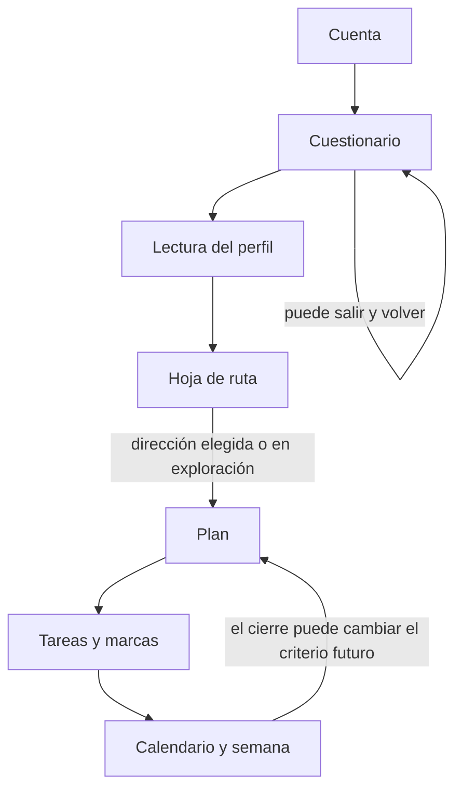
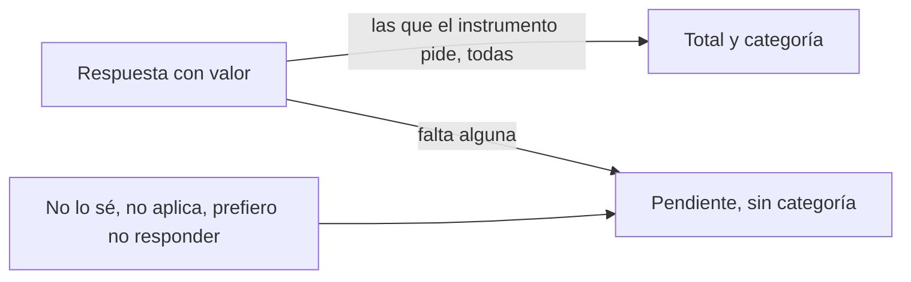
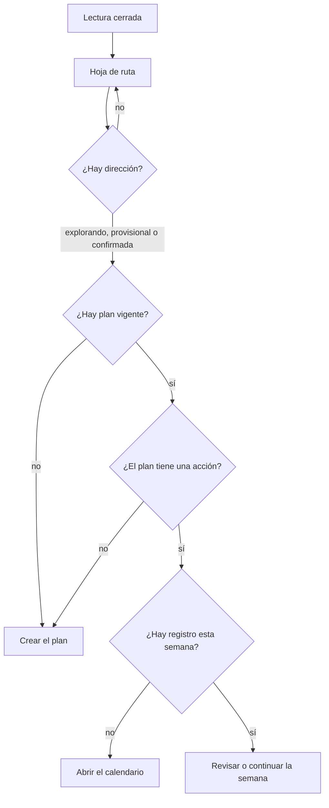

# Cómo quedó el proyecto y cómo se lee

Estado al 12 oct 2026, noche. Una sesión nueva usa `formulario-completo@5`. `@1` a `@4` siguen con sus sesiones. `@4` dejó las actividades de IKIGAI marcadas como pasión; al leerlas, la fila de la fuente corrige el campo. El detalle está en `MK_IMPLEMENTATION_PROGRESS.md`.

## El producto en una página

Inicio no inventa un número para Mente, Espíritu y Cuerpo. Esos círculos siguen sin cifra. La lectura del formulario vive en Perfil. La ficha de alineación declarada, si se guardó, aparece en Inicio, Perfil y Hoja de ruta. Es otro dato. No sale del cuestionario y no abre ni cierra el plan.

## Qué entra en un puntaje y qué no

Una excepción no se convierte en cero ni en «No». Si falta una respuesta que el instrumento necesita, no hay total. Hay cobertura: cuántas hay y cuántas hacían falta. Un instrumento incompleto no borra a los que sí están completos.

El cuerpo, el origen, la visión, los valores, los estándares, IKIGAI y la huella no producen un índice. Se guardan como texto, listas o números con unidad. Cada actividad de IKIGAI guarda ámbito, opción dependiente y respuesta específica. El cruce es una elección de la persona, con valoración cualitativa y sin puntaje. El propósito editable no sale de sumar la auditoría.

## Instrumentos que sí calculan

Cada fila es una suma, salvo personalidad, que es un promedio de tres. El total existe solo con la cobertura completa.

| Instrumento | Qué se responde | Rango | Cuándo hay total | Qué se muestra |
| --- | --- | --- | --- | --- |
| Auditoría | 23 frases, de 1 a 5 | 23 a 115 | 23 de 23 | Total y categoría del formulario |
| Desarrollo y sentido | 10 frases, de 1 a 5 | 10 a 50 | 10 de 10 | Total, aparte. Sin bandas |
| Relaciones | 12 frases, de 1 a 5 | 12 a 60 | 12 de 12 | Total y banda |
| Finanzas | 12 frases, de 1 a 5 | 12 a 60 | 12 de 12 | Total y banda. La proyección no entra |
| Identidad | 10 frases, de 1 a 4 | 10 a 40 | 10 de 10 | Total. Sin categoría formal |
| Dificultades | 5 grupos de 9. Sí = 2, más o menos = 1, no = 0 | 0 a 18 por grupo | 9 de 9 en ese grupo | Cinco números. Sin total único |
| Personalidad | 5 factores de 3 frases, de 1 a 5 | promedio 1 a 5 | 3 de 3 en ese factor | Cinco lecturas. Sin promedio global |

### Auditoría

Suma las secciones 1 a 5. Son 23 ítems. La sección 6 no entra en los 115.

| Total | Texto en el perfil |
| --- | --- |
| Menos de 46 | Por debajo de 46 |
| 46 a 68 | De 46 a 68 |
| 69 a 91 | De 69 a 91 |
| 92 a 115 | De 92 a 115 |

Eso es la categoría del formulario. No es un juicio de capacidad. El promedio de porcentajes de secciones de distinto tamaño no se usa.

En las secciones 4 y 5, una respuesta 1 o 2 dispara «Conviene revisar esta respuesta». En el formulario original la alerta de esas secciones era solo el 2. El 1 se atiende igual para no dejarlo fuera. No bloquea el plan.

### Desarrollo y sentido

Diez ítems de la misma hoja de auditoría, leídos aparte. Si están los diez, hay un total de 10 a 50. No se suma a la auditoría y no tiene bandas.

### Relaciones

Doce ítems, cuatro ámbitos de tres: pareja o núcleo íntimo, familia, amistades, entorno laboral.

| Total | Código guardado | Texto en el perfil |
| --- | --- | --- |
| 12 a 28 | DETRIMENTO | Detrimento |
| 29 a 48 | ALERTA | Calibración |
| 49 a 60 | PROPULSOR | Propulsor |

### Finanzas

Doce ítems de suficiencia, ahorro, inversión y deudas. Las preguntas de proyección se guardan como texto y no entran en el 60.

| Total | Código guardado | Texto en el perfil |
| --- | --- | --- |
| 12 a 24 | CRÍTICO | Crítico |
| 25 a 44 | ALERTA | Calibración |
| 45 a 60 | ÓPTIMO | Óptimo |

### Identidad

Diez ítems de 1 a 4. El total va de 10 a 40. 34 y 35 no reciben una categoría: el formulario no las clasifica y la categoría formal sigue en definición.

### Dificultades y recursos

Cinco grupos, nueve frases cada uno. No se suman entre sí. Un grupo alto de interferencia no se compensa con los recursos.

| Código en pantalla | Lectura |
| --- | --- |
| PR, ER, PY, D | Interferencia de ese grupo, de 0 a 18 |
| IN | Recursos de integración, de 0 a 18 |

Cada tres frases muestran el grupo y el ámbito del formulario: por ejemplo, patrones repetitivos y relaciones interpersonales.

Ejemplos del tipo de frase, no el nombre del grupo: PR habla de vínculos que controlan, ER de emoción negada, PY de irritación con otros, D de justificar la falta de acción, IN de comprometerse a decir que no.

### Personalidad

Cinco factores: apertura, responsabilidad, extraversión, amabilidad, sensibilidad emocional. Cada uno tiene tres frases. La del medio se invierte: si la persona marca 5, cuenta como 1, porque el ítem está redactado al revés. La cuenta es 6 menos la respuesta. El factor es el promedio de las tres, solo si las tres están.

| Promedio | Lectura |
| --- | --- |
| 4 o más | Alta |
| Más de 2,4 y menos de 4 | Intermedia |
| 2,4 o menos | Baja |

En sensibilidad emocional, alto quiere decir más reactividad. Bajo quiere decir más calma bajo presión. En ningún factor un número mayor significa una persona mejor. No hay un promedio de los cinco ni un arquetipo.

## Lo que se guarda y no se puntúa

| Bloque | Qué queda | Qué no se calcula |
| --- | --- | --- |
| Cuerpo | Edad, sexo, altura, peso, grasa si se conoce, listas de salud, comida, actividad, sueño, percepción | Un índice corporal |
| Origen, visión, valores, estándares, huella | Texto, y en valores una lista de hasta 10 más 3 esenciales tomados de esa lista | Un puntaje de propósito |
| IKIGAI | Actividad y otros campos donde también se reconoce | El cruce numérico |
| Sueño | Horas, de 0 a 14 | Un diagnóstico. Menos de 6 horas es una alerta de fórmula, no un límite médico |

Grasa corporal se pide de 0 a 100. 20 es 20 por ciento. «No lo sé» no se guarda como 0.

## Alineación declarada, aparte

Nueve preguntas de 1 a 5 en la hoja de ruta, no en el cuestionario. «No tengo información suficiente» deja ese criterio pendiente y no cuenta como 1.

Cada respuesta se pasa a 0, 25, 50, 75 o 100 con la cuenta `25 × (respuesta − 1)`.

Un pilar (espíritu, mente o cuerpo) es el promedio de sus tres respuestas, solo con 3 de 3. El total es el promedio de los tres pilares, solo con 9 de 9. Nueve veces 1 da 0. Nueve veces 5 da 100. Espíritu 75, mente 50 y cuerpo 25 dan 50.

En pantalla dice «Alineación declarada» y «método en revisión». No sustituye la lectura del perfil y no decide el plan, el acceso ni un precio.

## Después de la lectura

La dirección puede quedar en exploración. No hace falta firmar la hoja para crear el plan. La firma, si se usa, guarda el texto de esa revisión. Guardar la ficha de alineación no borra la firma.

El plan pide un vínculo con esa dirección: directo, habilitante, protege algo, o exploratorio. Sin cuestionario cerrado, o sin dirección, el servidor no guarda el plan ni la tarea. Entrar a Mente, Espíritu o Cuerpo no crea un plan solo.

Cada tarea puede marcar si implica esfuerzo físico, dieta, suplemento, medicación, confrontación, inversión o deuda. Sin marcas, se guarda. Eso no certifica que la tarea sea inocua: nadie marcó nada.

| Marca | Qué hace el servidor |
| --- | --- |
| Esfuerzo, dieta, suplemento, medicación | Si las respuestas de salud son un «No» exacto, la marca se guarda. Si el texto es otra cosa, pide aclarar. No lo trata como un límite confirmado hasta que la persona lo dice |
| Confrontación | Pide si esa conversación se puede hacer. Preparar el paso sin la marca sigue pudiendo guardarse |
| Inversión o deuda | No se proponen. La alternativa es ordenar la información |

La semana guarda un registro por acción y día. Al cerrarla queda una foto: la semana cerrada sigue mostrando el criterio de entonces. Mantener deja la acción. Modificar escribe un criterio nuevo hacia adelante y rechaza una modificación vacía. Retirar desactiva la acción y conserva lo ya registrado. Repetir el cierre devuelve la misma semana.

## Qué todavía no está

No hay ocasiones con horizonte de 21 días, ni una revisión que cambie la frecuencia o sustituya el paso dejando el criterio igual. El cierre de semana cambia el criterio, retira o mantiene. No es todavía esa revisión más amplia.

Las filas que faltaban en el cuerpo y la pregunta de herencia de origen entran en la revisión 3. Las sesiones anteriores no cambian.
